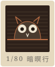

# 銅版蝕刻・飛塵 Aguafuerte y Aguatinta（Goya《隨想集》式）

## 1. 設計哲學

銅版蝕刻不是「用線畫」，是「讓酸替你畫」。畫家只做三件事：用針劃開防蝕蠟、決定每一條線在酸裡泡多久、決定哪裡要用停蝕漆蓋住。黑是被咬出來的、亮是被保護下來的；最後擦版與壓印再把一層手的痕跡加回去。所以這個風格的每一個視覺決定都要回答一個製程問題：**這一塊是第幾次浸酸？這一塊有沒有被蓋住？這一塊墨擦掉了多少？紙被壓在哪裡？**

- 年代與地域：蝕刻 16 世紀初出現在奧格斯堡的盔甲裝飾（Daniel Hopfer，鐵版），Dürer 1515–18 試過五張；17 世紀 Callot 的硬底與 Rembrandt 約三百張蝕刻把它變成畫家的媒材；1768 年左右 Jean-Baptiste Le Prince 發展出松香飛塵 aquatint；Goya 1797–99 年以蝕刻＋飛塵＋乾刻＋雕刀做成《Los Caprichos》80 張，1799 年 2 月 6 日《馬德里日報》刊登，一套 320 里爾，在醒悟街一號一間賣利口酒與香水的店裡販售，300 套只賣出 27 套後撤下，1803 年連同銅版獻給國王（今藏馬德里國立版畫局 Calcografía Nacional）。
- 製程限制塑造了樣子：針尖粗細固定 → 線寬幾乎不變，深淺只能靠浸酸次數；松香粉是一粒一粒的 → 面的灰永遠是網狀顆粒，不是平滑漸層；停蝕是用筆塗的 → 亮部邊緣是硬的、有筆觸；擦版是手 → 版面殘墨不均勻、邊角較濃；凹版機壓力 → 紙上留下凹陷的版痕。
- 本站：臺北文山「暗暝行」夜觀社。夜是飛塵最擅長的題材（Goya 第 43 號那群貓頭鷹與蝙蝠就是飛塵咬出來的黑），夜觀看見的動物＝銅版要刻的東西；Piranesi 的羅馬景觀版畫賣給壯遊旅人當紀念品，正是「走完夜路帶一張版畫回家」的歷史前例。

| 維度 | 本站設定 |
|---|---|
| era 時代 | 1799 馬德里 × 1976–2026 木柵 |
| locale 地域 | 指南路三段茶農倉庫、樟湖步道 |
| voice 性格 | 哥雅式短句題詞（「牠先看見你」）、版畫師傅的製程口吻 |
| texture 質感 | 棉紙纖維、松香網點、版面殘墨、版痕凹陷 |
| density 密度 | 一屏一張版；文字住在紙的留白與鉛筆邊註裡 |
| function 功能 | 〈蝕一張〉工序體驗：畫三輪、浸三次酸、撒飛塵、擦版、壓印，產出一張帶版痕與鉛筆編號的 PNG |

## 2. 色彩系統

| Token | Hex | 用途 | 面積 |
|---|---|---|---|
| `--paper` | `#EEE5D1` | 棉紙（全站底色、最亮值） | 45% |
| `--paper-2` | `#E5D9BF` | 版痕內的紙（被壓過略暗） | 10% |
| `--ink` | `#231A14` | 暖黑蝕刻墨（Rembrandt 式偏褐的黑），正文 | 25%（多半在版畫內） |
| `--ink-2` / `--ink-3` | `#4A3B2E` / `#7A6A58` | 次級文字、題詞說明 | 6% |
| `--pencil` | `#6E6A63` | 鉛筆邊註：編號、標題、簽名、年表 | 4% |
| `--copper` / `--copper-2` | `#B26A43` / `#D99A6C` | 只給「銅版本身」：壓印機上的版、工作台上被劃開的線 | 6% |
| `--ground` | `#2E211A` | 防蝕蠟 | 工作台 |
| `--red` | `#A8322B` | 紅光手電筒：唯一彩色，現用頁、focus、手電筒光束、警示 | ≤2% |

規則：**版畫內部只准一種墨**；任何「顏色」只能出現在版畫外（紅光手電筒是照在紙上的光，不是印上去的墨）。零漸層填色（唯一的漸層是紙的微光與滾筒金屬）、零純黑、零純白。

## 3. 字體系統

- 題詞與鉛筆字：**LXGW WenKai TC** 300/400（Google Fonts）——鉛筆邊註用 300、`--pencil` 色；版內題詞用 400、以 `mix-blend-mode:screen` 疊在暗部上，像刻在版裡、印成白字。
- 內文與標題：**Noto Serif TC** 400／600，標題字距 .06–.1em。
- 拉丁字：**IM Fell English**（以 17 世紀 Fell 鉛字復刻）正體與斜體，只做 kicker、版號 Nº、西班牙文製程詞。
- 字級：h1 `clamp(28px,3.6vw,50px)`、h2 22–34px、內文 17px/1.85、鉛筆 15–17px、版號 11–15px。**禁止粗於 600**；強調靠大小與位置。

## 4. 版面與網格

- 每一屏的主角是一張「紙」：版畫外圍要有比例正確的紙邊——左右各 ≥8%、上 ≥6.5%、下 ≥12%（鉛筆字住在下邊）。
- 版痕（platemark）是一切元件的容器：價目表、路線圖、你做出來的那張都放在版痕裡。
- 不對稱：圖版與說明交錯（7/12 對 4/12，每三張換一次位置），不排成整齊卡片牆。
- 版畫不旋轉；只有「從壓印機掀起來」那一刻允許 −1.2° 的微斜。
- 導覽在紙的下緣，用鉛筆寫成版次分數（Nº 1/4…Nº 4/4）。

## 5. 元件配方

**版痕 Plate**
```css
.plate{position:relative;background:#E5D9BF;border-radius:3px;
 box-shadow:inset 1px 1px 0 rgba(255,255,255,.55),inset -1px -1px 0 rgba(60,40,20,.20),
  0 0 0 1px rgba(60,40,20,.07),2px 2px 0 rgba(255,253,244,.7),-1px -1px 0 rgba(90,64,40,.22),3px 4px 6px rgba(70,50,30,.10)}
```
**鉛筆編號列**：`<div class="pencil"><span>18/30</span><span class="t">標題</span><span>簽名 年份</span></div>`，三段式 flex、WenKai 300、灰。

**導覽 pencil-margin**：fixed 底部、紙色漸層襯底；每一項 `<i>Nº 2/4</i>八種眼睛`；現用頁改紅色並出現一道手寫底線 SVG（`M2 6 C 18 2, 30 8, 46 5 S 78 3, 98 6`）。

**按鈕**：1px 墨框、2px 實色位移影（像壓印機的平台）、按下位移歸零；紅色版只給「浸酸」「轉滾筒」等不可逆動作。

**表單**：只有底線的輸入框（像在紙上用鉛筆填），WenKai 字。

**Footer = imprint**：版畫印刷所落款式三欄，最後一行義／西文斜體 imprint。

## 6. 動效規則（4 種，皆有 reduced-motion 降級）

| 類型 | 本站實作 | 觸發 / 時長 / easing | reduced-motion |
|---|---|---|---|
| ambient 環境 | 紅光手電筒光束在首頁版畫上緩慢游移（`mix-blend-mode:screen` 的徑向光斑）＋鴞眼每 7.3 秒眨一次 | 自動；26s `ease-in-out infinite alternate`；眨眼 7.3s 中佔 5% | 光斑靜止於中央、不眨眼 |
| input 輸入 | 斜光看版痕：游標方位（手機為 DeviceOrientation 傾斜）→ `feDistantLight azimuth`，版痕凹邊的亮暗即時旋轉；工作台針線即時劃出 | pointermove → rAF 追隨係數 .35，<16ms | 光直接跳到目標方位，無追隨 |
| transition 轉場 | 紗布擦版轉場：一片帶交叉紗紋的殘墨色以 clip-path 斜掃過畫面再掃出 | 換頁點擊；出 .44s／入 .52s `cubic-bezier(.6,.05,.3,1)` | 不攔截連結，直接換頁 |
| signature 簽名 | **過壓印機**：首頁捲動驅動滾筒走過銅版，左右相反的銅版被一張紙蓋住、印出正向的版畫，最後紙被掀起微斜 | `animation-timeline: --press`（view-timeline）；range contain 8%→78% 印、80%→98% 掀 | 直接顯示印好的那張與說明文字 |

本站自我限制：不用淡入揭示；不用數字計數；不用視差。

## 7. 插畫與圖像風格（etch-bite-aquatint）

圖像只由四種製程原語生成，**不准有「描一個形再填色」**：
1. **針線**：等寬、帶手抖（沿路徑法向 value noise ±0.9 單位），線寬只隨浸酸次數增加（側蝕）：`hw = 0.45 + 0.22 × bites`。
2. **排線**：平行線裁進多邊形，間距 4–7 單位、每條起訖內縮隨機 0–1.5；交叉線的咬酸次數比主排線少一次。
3. **飛塵**：0–4 階；每一階一個閾值（.60/.50/.42/.34）把雙八度 value noise 轉成「白粒＋被咬的網」，深度權重 .5/1.0/1.6/2.5。
4. **停蝕**：tone 0 的多邊形＝紙白——眼睛反光、螢火、月亮。**亮一定是被保護下來的，不能是畫上去的白。**
加上全版 1/5200 的 foul-bite 雜點與版面殘墨。動物一律是夜行性的；夜空永遠是飛塵。

## 8. Logo 與 Favicon

Logo：一張縮小的版畫——棉紙邊、版痕、防蝕蠟色的版面上一排平行針線、一隻只有輪廓與兩顆停蝕白眼的鴞，下緣鉛筆寫「1/80 暗暝行」。Favicon：32×32 紙色底＋銅邊暗版＋兩顆白眼。兩者都不得出現漸層與文字以外的彩色。

## 9. Do & Don't

- Do：所有灰都是顆粒；所有白都是紙；所有編號都是鉛筆；所有版畫都有版痕。
- Do：題詞學哥雅——短、帶一點嘲諷或警句，放在版內下緣。
- Don't：用 CSS `filter:sepia()` 把照片「做舊」冒充版畫。
- Don't：平滑漸層天空、模糊陰影、圓角卡片、emoji、紫藍漸層、置中三卡片、EST. 徽章。
- Don't：把線寬當作表現手段（那是雕凹版 burin 的語言）；蝕刻的線寬只隨酸改變。
- Don't：在版畫內使用第二種墨色。

## 10. 頁面骨架範例

```html
<header class="brand"><div><b>暗暝行</b><small>nocturnes &amp; etchings</small></div></header>
<section class="press" style="view-timeline:--press block">
  <div class="stage">
    <div class="lede"><p class="kicker">Nº 47 / 80</p><h1>人睡去的時候，山才醒來。</h1></div>
    <div class="bed">
      <div class="cu"><canvas id="plate"></canvas></div>          <!-- 左右相反的銅版 -->
      <div class="sheetP">                                         <!-- 被滾筒逐行揭開的紙 -->
        <figure class="plate"><canvas id="print"></canvas><span class="cap">牠先看見你</span>
          <svg class="rake"><rect filter="url(#rake)" fill="#fff"/></svg></figure>
        <div class="pencil"><span>18/30</span><span class="t">暗暝第四十七</span><span>黃秋霖 2025</span></div>
      </div>
      <div class="roller"></div>
    </div>
  </div>
</section>
<nav class="pm"><a href="index.html" aria-current="page"><i>Nº 1/4</i>夜的版</a>…</nav>
```

## 11. 本風格的 5 個不可省略特徵

### ① 針線的黑來自浸酸次數，不來自筆寬（拿掉它，就是一般的鋼筆線畫）
先畫的線泡最多次酸，最黑也最寬；最後畫的最淡最細。同一條線全程等寬、帶微抖。
```js
// 第 r 輪畫下的線、共浸了 B 次酸 → 被咬 B-r+1 次
const bites = B >= r ? B - r + 1 : 0;           // 0 = 印不出來
const hw = (0.45 + 0.22*bites) * scale + 0.15;   // 側蝕：越咬越寬
const value = 0.62 + 0.38*bites;                 // 越咬越深
```
```css
/* 無 canvas 時的近似：三種咬酸等級 */
.l1{stroke:#6b5a4a;stroke-width:.8}.l2{stroke:#3d2f24;stroke-width:1.05}.l3{stroke:#231A14;stroke-width:1.3}
```

### ② 飛塵的網狀顆粒＋停蝕硬邊（拿掉它，就是線刻版畫或木刻）
面的灰只能是「白色松香粒＋周圍被咬成網」；分階是用停蝕漆一層層蓋，邊緣是硬的。
```js
const TW=[0,.5,1.0,1.6,2.5], TH=[0,.6,.5,.42,.34];
let g = vnoise(x*.5,y*.5)*.62 + vnoise(x*1.1,y*1.1)*.38;
let q = smoothstep(TH[t]-.09, TH[t]+.09, g);     // 粒與網
depth += TW[t]*(0.3+0.7*q);
```
```svg
<!-- SVG 近似：雜訊閾值化的飛塵 -->
<filter id="aq"><feTurbulence type="fractalNoise" baseFrequency=".9" numOctaves="2"/>
<feColorMatrix type="matrix" values="0 0 0 0 .14  0 0 0 0 .10  0 0 0 0 .08  0 0 0 -2.6 1.9"/></filter>
```

### ③ 版面殘墨（拿掉它，就像雷射印表機印的）
擦版留下的一層薄墨：邊角較濃、沿擦拭方向有條紋、可被手擦淡。
```js
const edge = Math.max(0, 1 - Math.min(ex,ey)*7.5) ** 2;
const streak = .75 + .5*vnoise(x*.012, y*.22);   // 橫向擦痕
let film = plateTone*(.18+.82*edge)*streak*.22*wipe[i];
ink = 1 - (1-ink)*(1-film);
```

### ④ 版痕＋鉛筆編號（拿掉它，就不是一張「版畫」而只是一張圖）
紙被壓進版的四邊：內陷斜邊、四角微圓、版內紙色略暗；版痕下方鉛筆寫 `編號/總數｜標題｜簽名 年份`。
```css
.plate{background:#E5D9BF;border-radius:3px;box-shadow:inset 1px 1px 0 rgba(255,255,255,.55),inset -1px -1px 0 rgba(60,40,20,.2),2px 2px 0 rgba(255,253,244,.7),-1px -1px 0 rgba(90,64,40,.22)}
.pencil{display:flex;justify-content:space-between;font:300 15px "LXGW WenKai TC";color:#6E6A63}
```
```svg
<filter id="rake" color-interpolation-filters="sRGB"><feGaussianBlur in="SourceAlpha" stdDeviation="2.4"/>
<feDiffuseLighting surfaceScale="-6" lighting-color="#fff"><feDistantLight azimuth="225" elevation="30"/></feDiffuseLighting></filter>
<!-- 疊在版畫上 mix-blend-mode:soft-light；elevation 30° 使平面 N·L=.5 → 中性 -->
```

### ⑤ 版內刻字：版號＋哥雅式題詞（拿掉它，就失去「一套連作」的語法）
右上角 IM Fell 斜體 `Nº 12`，下緣一句短題詞，以亮字印在暗部上。
```css
.plate .no{position:absolute;right:3.2%;top:2.4%;font:italic 13px "IM Fell English";color:#E9DFC8;mix-blend-mode:screen}
.plate .cap{position:absolute;left:0;right:0;bottom:4.2%;text-align:center;font:400 16px "LXGW WenKai TC";color:#F1E8D4;mix-blend-mode:screen}
```

## 12. 技術實作與相容性

### (a) 核心技術與查證（2026-10-17 查證）

| 技術 | 本站承載 | 支援現況 | 來源 |
|---|---|---|---|
| **OffscreenCanvas `transferControlToOffscreen()` ＋ Blob Worker**（A 渲染層） | 全站唯一圖像引擎「酸」：深度緩衝累積針線／排線／飛塵／停蝕 → 擦版殘墨 → 版或紙的著色，全部在背景執行緒；首頁兩張、八種眼睛八張、工具三次（上墨、壓印）。工具的成品以 worker 內 `new OffscreenCanvas()` → `transferToImageBitmap()` 傳回 | MDN 標示 Baseline Widely available（2023-03 起全瀏覽器） | MDN〈OffscreenCanvas〉 |
| **CSS scroll-driven animations：`view-timeline` ＋ `animation-timeline` ＋ `animation-range`**（B 動效層） | 簽名「過壓印機」：滾筒位置、紙的 clip-path 揭開、掀起微斜、四段步驟註記，全部綁在 `--press` 時間軸上，零 JS | caniuse（2026-09 資料）：Chrome／Edge 115+、Safari 26.0+、iOS Safari 26.0+、Samsung 23+；Firefox 161 起支援、157–160 不支援 | caniuse〈CSS property: animation-timeline〉、〈animation-timeline: view()〉 |
| **SVG `feDiffuseLighting` ＋ `feDistantLight`，方位由 Pointer／DeviceOrientation 驅動**（A 渲染／D 輸入） | 特徵④的版痕凹邊與紙纖維隨光轉；`elevation=30°` 讓平面 N·L＝0.5，`soft-light` 疊合下平面完全中性，只有斜邊被照亮或壓暗 | MDN：feDiffuseLighting、feDistantLight／fePointLight 皆 Baseline Widely available（2015-07 起）；DeviceOrientation 在 iOS 需 `requestPermission()` 於點擊內呼叫 | MDN〈feDiffuseLighting〉〈fePointLight〉 |

### (b) Fallback 具體行為
- 無 `transferControlToOffscreen`：同一支 worker 算完把 `Uint8ClampedArray` 以 transferable 傳回主執行緒 `putImageData`。
- 無 Worker（或 worker 出錯）：同一份引擎原始碼（`<script type="text/plain" id="etch-src">`）以 indirect eval 在主執行緒執行。
- 無 `animation-timeline`（如 Firefox ≤160）：`CSS.supports('animation-timeline: view()')` 為假時加 `.js-fallback`，以 passive scroll＋rAF 計算同一組 0–1 進度寫入 clip-path／top／transform，行為與 CSS 版一致。
- `prefers-reduced-motion`：不做 sticky 壓印，直接顯示印好的版與一行說明；光束與眨眼停止；轉場不攔截；氣泡動畫略過但浸酸狀態文字照樣更新——資訊零損失。
- 無 JS：`<noscript>` 說明，所有場次、價格、物種文字皆為 HTML 本文可讀；路線圖為純 SVG。

### (c) 效能實測（本輪環境無瀏覽器；以同一份 engine.js 在 Node 22／V8 單執行緒量測）
- 首頁版畫 600×804：深度＋著色約 190–250 ms（在 worker，主執行緒為 0）；銅版 420×563 約 90 ms。
- 八種眼睛單張 500×360：45–80 ms；以 IntersectionObserver 提前 400px 才排入 worker。
- 工具壓印 1000×720（含擦版圖雙線性放大與鏡像）：約 200 ms，於滾筒動畫 1.3 s 內完成。
- 首屏主執行緒 JS：建立 Blob worker、量測一次尺寸、兩次 postMessage，<10 ms；壓印與擦版動畫只動 transform／clip-path。
- 單頁大小：index 約 51 KB、eyes 約 45 KB、etch 約 56 KB、visit 約 24 KB（全部 inline，遠低於 350 KB）。
