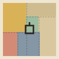

# 조각보 · 透光苧麻碎布包巾 Jogakbo

> 這份規格書描述朝鮮王朝（1392–1910）以來民間婦女用剪剩的碎布拼成的包巾「조각보 jogakbo」（보자기 bojagi 的拼布型），網頁化為一套可重用的視覺語言。示範站是永和中興街一家修改衣服店，但風格不綁產業：任何「把零碎的東西接成一整塊」的品牌都適用——二手、修補、拼裝、共同創作、社區。

## 一、設計哲學

1. **布是半透明的，光在布後面。** 조각보最常見的料是모시（苧麻），平織、薄、有光澤。掛在窗前時，兩層布重疊的地方光少一半——縫份因此變成一格一格的深線，V&A 稱之為「window pane」窗格外觀。網頁上的每一個色塊都必須「疊在光上」，而不是「蓋在底上」：用 `mix-blend-mode: multiply`，不用不透明色塊。
2. **縫份是線，不是空隙。** 塊與塊之間沒有 gap、沒有白邊，而是**互相重疊 2–3px**。重疊處自動相乘變深＝깁기（gekki）三道縫留下的那條平線。
3. **形狀是剪剩的，所以只有矩形，而且每一塊都不一樣。** 碎布來自韓服袖口弧線、褲管改短、窗簾改窄——尺寸由剪下來的東西決定，不是由網格決定。拼法是即興的：先接成小方塊，再往外長，直到夠大。
4. **針腳不藏。** 民間做조각보的人相信每一針、每一塊都替被包起來的東西多存一點福（복）。針腳是裝飾本身。
5. **它是一件用來包東西的布。** 正方形外輪廓、中央提環（蓋飯菜的상보）、四角繫帶、打結——這些「用途的痕跡」要出現在介面上。

外部參照：V&A〈Jogakbo – traditional Korean patchwork〉（about 1940 苧麻조각보 FE.303-2011；Chunghie Lee 1990s 作品）；Wikipedia〈Bojagi〉（pok 幅 ≈35 cm、min-bo／gung-bo、상보提環）；Museum of Korean Embroidery（許東華・朴英淑 1976 創立，2018 捐贈首爾工藝博物館）；Young-Key Kim-Renaud ed.《Creative Women of Korea》2004；Huh Dong-hwa〈History and Art in Traditional Wrapping Cloths〉《Wrappings of Happiness》Honolulu Academy of Arts 2003。常被拿來和 Mondrian、Paul Klee 比較——分界見第十章。

## 二、本風格的 5 個不可省略特徵

拿掉任何一項，它就退化成「彩色方格」或「蒙德里安」。

### 特徵 1：縫份＝重疊相乘的深線（깁기 window pane）

塊與塊互相吃進 `--seam`（2px）。不畫邊框；深線是兩層半透明布重疊的結果。

```css
:root{--seam:2px}
.jg{display:grid;gap:0;padding:var(--seam)}
.p{position:relative;background:var(--c);mix-blend-mode:multiply;margin:calc(var(--seam) * -1);
   padding:calc(14px + var(--seam)) calc(16px + var(--seam))}
```

### 特徵 2：苧麻透光——所有色塊相乘疊在「窗光」上

頁面底不是紙，是光：一層底色＋一盞暖白燈（徑向漸層，燈不是布，這是全站唯一允許的漸層）。色塊 `multiply`，所以燈移過去，布就亮起來；兩層的地方永遠比一層暗。**禁止**不透明色塊、`opacity` 造淺色、陰影。

```css
body{background:radial-gradient(circle at var(--lx) var(--ly),var(--lamp) 0,rgba(255,249,236,0) 44vmax) fixed,var(--dim)}
/* 有 transform 的容器（會隔離混合）要自帶一盞燈 */
.bo{background:radial-gradient(circle at var(--bx,50%) var(--by,30%),var(--lamp) 0,rgba(255,249,236,0) 62%),var(--dim)}
```

### 特徵 3：只有矩形、不規則拼接、每塊不同

無圓角、無圓、無斜切（中央提環與結除外）。版面用 `grid-template-areas` 或 guillotine 遞迴切割產生，**不可**等分格。同一畫面不得出現兩塊同尺寸同色的布。

```css
.bo{display:grid;grid-template-columns:repeat(8,1fr);grid-template-rows:repeat(8,1fr);
 grid-template-areas:"a a a b b c c c" "a a a b b c c c" "a a a d d d e e" "f f g d d d e e"
                     "f f g h h h e e" "f f g h h h i i" "j j j j k k i i" "j j j j k k i i"}
```

### 特徵 4：看得見的針腳

每一塊沿縫份走一道虛線（running stitch），正好落在重疊帶中央。

```css
.p::before{content:"";position:absolute;inset:calc(var(--seam) - 1px);border:1px dashed rgba(42,35,30,.34);pointer-events:none}
```

### 特徵 5：包巾的用途痕跡——正方外形、中央提環、四角打結

主構圖一律是正方形（1 幅＝35 cm＝8 格）；中央放一個方形提環；轉場是四角折向中心打結。

```html
<span class="loop" aria-hidden="true"></span>
<style>.loop{position:absolute;left:50%;top:50%;width:26px;height:20px;margin:-10px 0 0 -13px;border:4px solid #34496E;border-bottom:0}
.loop::after{content:"";position:absolute;left:-8px;right:-8px;bottom:-6px;height:6px;background:#34496E}</style>
```

## 三、色彩系統

本色苧麻佔大宗，五方色（오방색）只做點綴，全部是「染過的麻」的淺彩度，因為它們要相乘疊在光上。

| Token | Hex | 用途 | 比例 |
|---|---|---|---|
| `--r1` 모시 本色 | `#E7DDC2` | 主要布塊 | 22% |
| `--r2` 모시 舊色 | `#DDD0B0` | 主要布塊 | 18% |
| `--r3` 모시 漂白 | `#EEE6D1` | 長文布塊、標籤底 | 18% |
| `--chija` 치자 梔子 | `#E9C46A` | 主行動、第一塊 | 8% |
| `--ok` 옥색 玉色 | `#A9D0C3` | 次行動 | 6% |
| `--ssuk` 쑥 艾草 | `#A9B583` | 來店／營業中 | 5% |
| `--hong` 홍 紅麻 | `#E39A8F` | 結、提環旁、強調 | 5% |
| `--jaju` 자주 紫麻 | `#C3A3BA` | 課程 | 4% |
| `--jjok` 쪽 藍 | `#8FA6C9` | 窄條、垂直字 | 4% |
| `--jjok2` 深藍 | `#34496E` | 提環、焦點框 | <1% |
| `--ink` 墨 | `#2A231E` | 文字 | — |
| `--wood` 窗框 | `#5B4332` | 掛桿、拼框 | 2% |
| `--dim` 窗光 | 依時刻：晨 `#E8D9B6`／日 `#E9E0C8`／午後 `#E9D2A6`／夜 `#D6CAAE` | 頁面底 | — |
| `--lamp` 燈 | `#FFF9EC`（夜 `#FFF0CF`） | 背光 | — |

規則：相乘後文字對比要過 4.5:1——所以彩色布一律淺彩度；夜間底色不得低於 `#D6CAAE`。同一排相鄰兩塊不得同色。

## 四、字體系統

- 中文：**Noto Serif TC** 400／700（Google Fonts）——明朝體配苧麻的手工感。
- 韓文與標籤：**Gowun Batang** 400／700（Google Fonts）——韓文明朝，筆畫細、像針線。所有 Hangul 以 `.ko` 指定。
- 字級：H1 `clamp(36px,5vw,62px)` 字距 .06–.08em；區段標 26px；布塊標題 `clamp(17px,2.3vw,30px)`；內文 16px／1.78；布標 `.k` 12px 700 字距 .08em；註 12–13px。
- 布塊內文字一律左上對齊，像縫上去的布標；窄長塊改直排 `writing-mode:vertical-rl`、字距 .3em。

## 五、版面與網格

- 每個內容區都是一塊「布」：`.jg` grid、gap 0、子項目負 margin 重疊。
- 主構圖是正方形 8×8（1 幅），用 `grid-template-areas` 手排或 guillotine 切割產生；次要區塊用 12 欄 `grid-auto-flow:dense` 讓不同寬度的布自動填滿。
- 零旋轉（掛著的那塊例外：±0.4° 隨風擺）。
- 留白規則：區段之間 40px 的「光」；布塊內 14–16px＋縫份。光（頁面底）就是留白，不另加白卡片。
- ≤760px：導覽碎布條落到底部；≤560px：正方形主構圖保留，次要說明藏起（`.hide-s`），所有 12 欄布塊改兩欄或單欄。

## 六、元件配方

- **導覽 조각띠 碎布條**：左側 72px 直條，Logo＋四塊不同高度（`flex: var(--f)`）的布，直排頁名＋韓文；現用頁那塊「摺了一層」（`::after` 上 42% 再疊一層同色 multiply）、往外 6px，右側伸出一條紅麻小繫帶。hover 往外 4px。
- **按鈕**：就是一小塊布：`background:var(--r2);mix-blend-mode:multiply` ＋內縮 3px 虛線針腳；主按鈕用梔子黃。無圓角無陰影。
- **卡片**：不存在「卡片」，只有布塊。布塊可帶 `data-from="來歷"`，hover／focus 時左下角浮出那塊布的出處（`content:attr(data-from)`）。
- **表單／遊戲框**：木色窗框 `--wood` 12px 包住一塊可放布的「光」，內畫極淡的 1px 格線（只在工作面上出現）。
- **頁尾**：三塊布並排，地址／剪下來的布去哪／連結＋虛構聲明。

## 七、動效規則

| 種類 | 本站實作 | 觸發 | 時長／曲線 | 減少動態 |
|---|---|---|---|---|
| ambient 環境 | 窗光依臺北時刻換色（晨／日／午後／夜）＋首頁掛著的조각보隨風擺 ±0.4° | 時間 | 背景色 4s linear；擺動 9s ease-in-out 無限 | 擺動停止；窗光照換（非動畫） |
| input 輸入 | 布塊 hover 抬起 3px 並浮出來歷布標；〈接一塊〉拖曳吸附、點一下轉 90°、放錯左右抖 | 游標／觸控／鍵盤 | 180ms cubic-bezier(.3,.7,.3,1)；抖 320ms | 抖動取消，狀態文字照出 |
| transition 轉場 | 包袱：離開時四角依上下左右折向中心、打結；抵達時解結攤開 | 站內連結 | 每角 400–520ms cubic-bezier(.62,0,.3,1)，角與角差 60–70ms，結 260ms | 直接換頁 |
| signature 簽名 | **布後持燈**：游標或手機傾斜（DeviceOrientation）移動布後的那盞燈；單層亮、縫份與摺層暗，層數就是深淺 | 游標／裝置傾斜 | rAF 同幀更新 | 燈仍跟隨使用者（使用者自己在動），無補間 |

首頁首訪另有「解包袱」：主構圖先被四角包住、中央打結，按「拉開結」或 3.2 秒後自動解開（每次瀏覽一次）。〈接一塊〉拼滿時每塊依序往外放 2px（420ms、間隔 230ms），縫份一道一道變深。

### motion-library 元件表（`wenxiangxiao/motion-library` v1.9.0 @6e9435f）

| 頁 | ID | 名稱 | 參數 | 角色 | 承載什麼／為什麼適合 |
|---|---|---|---|---|---|
| 福褓 | TXT-B-38 | Text Mosaic | text「福褓修改」、colors {primary #E39A8F, secondary #E9C46A, bg #EEE6D1}、duration 1.6、loop false、seed 1979 | transition（一次） | 店名從粗方塊逐步細分成字——像碎布一塊塊接成一整幅；元件只用矩形取樣，零圓角 |
| 福褓 | BG-B-16 | Weave Grid | colors {primary #DDD0B0, secondary #E7DDC2, bg #EEE6D1}、duration 14、density 1.5、intensity .45、seed 52 | ambient | 「今天的料」那塊布上的苧麻平織經緯緩慢滑動；intensity 壓低讓它的 3px 交織暗帶近似布紋而非陰影 |
| 接一塊 | SHP-13 | Fold Unfold | colors {primary #E9C46A, secondary #DDD0B0, bg #EEE6D1}、duration 2.4、loop true、seed 8 | ambient（拼完時 replay） | 四條布以梯形依序展開——摺邊／縫份的示意；純多邊形、無圓角 |
| 改衣 | TXT-A-35 | Stripe Mask | text「改衣 수선」、colors {primary #E39A8F, …, bg #EEE6D1}、duration 1.4、loop false、seed 12 | transition（一次） | 標題被一條條直條逐段「接」出來，2px 紅麻線像針在走 |
| 來店 | BG-A-12 | Broken Grid | colors {primary #5B4332, secondary #E9C46A, bg #E7DDC2}、duration 12、density .7、intensity .55、seed 1979 | ambient | 木色窗格（창살）微微錯動，少數格子透出梔子黃——窗與布的關係 |

出處：各元件 `MotionLib.prompt(id)`。掛載：等 `document.fonts.ready`、IntersectionObserver 離屏 `destroy()`、canvas `aria-hidden`、原 HTML 標題留在 `.ml-fb`；減少動態時背景 `seek(.35)`、文字 `seek(1)`。同一畫面最多兩個元件同時運轉。

## 八、插畫與圖像風格

全站沒有插畫，所有「圖」都是布：조각보構圖、碎布籃、상보與窗簾樣品、地圖（街區是布、街道是縫）。圖像規則＝特徵 1–5。要畫物件時，只能用矩形拼出來（例如結＝一方塊＋兩條斜置矩形耳）。

## 九、Logo 與 Favicon

Logo 是一幅 120×120 的迷你조각보：六塊矩形（梔子、舊麻、玉、本色、紅麻、藍）`mix-blend-mode:multiply` 疊在漂白麻底上，縫份以 1px 虛線標出，中央一個方形提環。Favicon 是同構的 4 塊版本（32×32、inline SVG data URI）。不得加圓角外框、不得加字標進方塊。

## 十、Do & Don't

**Do**：每塊布都相乘疊在光上；縫份用重疊而不是框線；尺寸由「剪剩」決定；讓布帶來歷（`data-from`）；保留中央提環或結。

**Don't**：
- 不要變成 Mondrian（De Stijl）：沒有粗黑框線、沒有純紅黃藍、沒有大面積白；我們的「線」是兩層布疊出來的半透明深色。
- 不要變成美式 quilt：沒有鋪棉、沒有重複區塊（log cabin／九宮格）、沒有印花布。
- 不要變成 Bento Grid：沒有圓角、沒有一致的溝寬、沒有「一格一卡片」的 UI。
- 不要不透明色塊、陰影、圓角、漸層（燈除外）、emoji、紫藍漸層、置中三卡片、Lorem ipsum、EST. 徽章。
- 不要把同一尺寸同一顏色的布並排兩次。

## 十一、頁面骨架範例

```html
<body>
<nav class="tti" aria-label="主要導覽">
  <a class="lg" href="index.html"></a>
  <a class="p tab" href="index.html" style="--c:var(--chija);--f:3" aria-current="page"><b>首頁</b><span class="ko">홈</span><i></i></a>
  <a class="p tab" href="b.html" style="--c:var(--ok);--f:3.8"><b>第二頁</b><span class="ko">둘</span></a>
</nav>
<main>
  <div class="bo lit">
    <a class="p" href="b.html" style="grid-area:a;--c:var(--chija)" data-from="梔子染樣布"><span class="k">잇기</span><h2>入口</h2></a>
    <!-- …其餘布塊依 grid-template-areas… -->
    <span class="loop" aria-hidden="true"></span>
  </div>
  <section class="jg" style="grid-template-columns:1.6fr 1fr 1.2fr">
    <div class="p" style="--c:var(--r1)">…</div><div class="p" style="--c:var(--r3)">…</div><div class="p" style="--c:var(--r2)">…</div>
  </section>
</main>
</body>
```

Guillotine 切割（保證拼得回去的碎布組）：

```js
function cut(W,H,n,m,r){var P=[{x:0,y:0,w:W,h:H}],g=0;
 while(P.length<n&&g++<600){P.sort((a,b)=>b.w*b.h-a.w*a.h);var i=Math.floor(r()*Math.min(3,P.length)),p=P[i],v=p.w>p.h?true:p.h>p.w?false:r()<.5,L=v?p.w:p.h;
  if(L<2*m){v=!v;L=v?p.w:p.h;if(L<2*m)continue;}var k=m+Math.floor(r()*(L-2*m+1));P.splice(i,1);
  P.push(...(v?[{x:p.x,y:p.y,w:k,h:p.h},{x:p.x+k,y:p.y,w:p.w-k,h:p.h}]:[{x:p.x,y:p.y,w:p.w,h:k},{x:p.x,y:p.y+k,w:p.w,h:p.h-k}]));}
 return P;}
```

## 十二、技術實作與相容性

| 技術 | 本站承載 | 支援現況（查證來源） | 不支援時 |
|---|---|---|---|
| `mix-blend-mode: multiply`（A 渲染層） | 特徵 1、2：縫份深線、透光、燈下發亮 | MDN 標示 Baseline Widely available（2020-01 起跨瀏覽器）；caniuse `mdn-css_properties_mix-blend-mode_multiply`：Chrome 41、Firefox 32、Safari 8、Edge 79 起 | 色塊照常顯示、只少了重疊加深；針腳虛線仍標出縫份位置。注意：任何帶 `transform`／`opacity`／`isolation` 的祖先都會隔離混合——那種容器要自帶一盞燈（`.bo` 的寫法） |
| `DeviceOrientationEvent`＋`requestPermission()`（D 輸入感測層） | signature：手機傾斜移動布後的燈 | MDN：DeviceOrientationEvent Baseline Widely available（2023-09），限安全環境；`requestPermission()` 標示 Experimental，iOS 13 起須在使用者手勢中呼叫 | 按鈕只在 `(pointer: coarse)` 出現；拒絕授權時燈改為跟著手指點的位置；桌機用游標 |
| Guillotine 遞迴切割＋FNV-1a→mulberry32 決定性亂數（E 資料生成層） | 今日碎布籃與〈接一塊〉：以臺北日期為種子切 8×8 成 7 塊（最小邊 2 格），保證有解，「指一塊」直接顯示生成時的位置 | 純 JS；`Intl.DateTimeFormat` timeZone 為 Baseline | 無 JS 時首頁顯示文字說明、遊戲頁請來店 |

其他：Web Animations API 做包袱轉場與縫合（不支援時直接換頁、直接放大 2px）；Pointer Events＋`setPointerCapture` 拖曳。

**效能實測**（jsdom 25 無頭執行，Node 22，含 motion-library 子集）：四頁腳本解析＋執行 36–57ms（首頁含冷啟動 174ms；瀏覽器實際約為其 1/3）；單頁 108–116KB（含 75KB 子集）。燈只改兩個 CSS 自訂屬性＋少數 `.lit` 容器的局部座標，rAF 節流，一幀一次。同一畫面最多兩個 canvas 元件。
