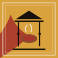

# 龐貝第三風格壁畫 Pompeian Third Style Wall — 規格書

> 範例站：〈火紅自助餐 HÓE-ÂNG〉（`sites/hue-ang`，臺南西門路自助餐）。本規格不綁定產業：任何「牆上本來就會寫字、會被熱或時間改變」的店家都適用——熱炒、酒館、浴場、烘焙、窯場、溫泉。

## 設計哲學

August Mau 在《Geschichte der decorativen Wandmalerei in Pompeji》（1882）把龐貝壁畫分成四種風格。**第三風格**（約西元前 20 年到西元 40 年代，奧古斯都時期，代表作：博斯科特雷卡塞 Boscotrecase 阿格里帕・波斯圖穆斯別墅的紅底與黑底房間、羅馬法爾內西納別墅）把第二風格的錯視建築**壓平**：牆不再假裝開了一扇窗、看出去是柱廊，而是變回一面牆——大片單色、磨到發亮的板，中間只放一件很小的東西。

維特魯威在《建築十書》第七書第五章罵過這種畫：「拿蘆葦代替柱子……拿燭台托著小神殿」——一根蘆葦撐不住屋頂，一支燭台也頂不起山牆。**這句抱怨就是第三風格的身分證**：建築元素細到不可能承重，純粹是裝飾的骨架。

本規格的三個態度：

1. **空是主角。** 一塊赭黃或黑板佔滿，板中央只有一隻漂浮的天鵝或一幅巴掌大的小景。不要填滿。
2. **牆是材料，不是背景色。** 石灰面上有抹刀方向、磨光反光與細裂紋；它會被熱改變（赭黃的針鐵礦加熱成赤鐵礦就變紅，回不去）。
3. **字是刷上去的。** 龐貝街上的選舉告示 programmata 與酒館價目，是先刷一塊石灰白、再用紅色毛筆寫。字不是印刷，是告示。

## 本風格的 5 個不可省略特徵

拿掉任何一項，畫面就不再是龐貝第三風格。

### ① 磨光的單色大板＋雙髮絲框

大面積赭黃 `#D9A23C`／龐貝紅 `#A8352A`／碳黑 `#17110E` 平塗板，板內除一件小景外全空；板以兩道石灰白髮絲線收邊（外 1px 實、內縮 6px 第二道半透明）。板面要有石灰質感（見「技術」章 WebGL 著色器；無 WebGL 時平塗即可，但髮絲框不可省）。

```css
.pan{position:relative;padding:clamp(18px,3cqi,40px)}
.pan::before,.pan::after{content:"";position:absolute;pointer-events:none}
.pan::before{inset:10px;border:1px solid rgba(238,230,214,.82)}
.pan::after{inset:16px;border:1px solid rgba(238,230,214,.38)}
.pan.k::before{border-color:rgba(23,17,14,.55)} /* 亮底板改用墨色髮絲 */
.o{background:#D9A23C}.r{background:#A8352A}.b{background:#17110E;color:#EEE6D6}
```

### ② 三段牆：黑牆裙／主區／白上楣

每一頁都是一面牆：下段 **dado**（黑底、植物枝 sprigs、上緣一道紅線）、中段 **主區**（左右對稱：側板｜燭台｜中央神龕 aedicula｜燭台｜側板）、上段 **frieze**（石灰白底，細建築、垂花、oscilla 圓盤）。頁首就是上楣，頁尾就是牆裙——不要用一般的 header bar／footer。

```html
<div class="wall">
  <header class="frieze"><svg class="arch">…細柱、山牆、垂花…</svg></header>
  <main><section class="zone">…主區…</section></main>
  <footer class="dado"><svg class="sprigs">…</svg>…</footer>
</div>
```
```css
.frieze{background:#EEE6D6;min-height:150px;border-bottom:10px solid #17110E}
.dado{background:#17110E;color:#EEE6D6;border-top:6px solid #7C2219}
.hero{display:grid;grid-template-columns:1fr var(--cand) minmax(260px,.86fr) var(--cand) 1fr}
```

### ③ 蘆葦燭台柱：撐不住任何東西的建築

柱寬 2–3px（隨容器 `cqi` 縮放），上面有一到兩個珠節與一片傘蓋，頂端托一座比例錯誤的小神龕。柱子永遠比它托的東西細得多。

```css
:root{--cand:max(2px,.24cqi)}
.cand{width:var(--cand);background:#EEE6D6;height:100%}
.cand::before{content:"";position:absolute;left:50%;top:22%;width:calc(var(--cand)*7);height:calc(var(--cand)*2.2);
  translate:-50% 0;border-radius:50% 50% 0 0/100% 100% 0 0;background:#EEE6D6} /* 傘蓋 */
.cand i{position:absolute;left:50%;width:calc(var(--cand)*3);aspect-ratio:1;translate:-50% 0;border-radius:50%;background:#EEE6D6} /* 珠節 */
```
```svg
<!-- 托著神龕的燭台（60×118） -->
<path d="M30 118V40" stroke="#EEE6D6" stroke-width="2"/><path d="M20 52Q30 44 40 52Z" fill="#EEE6D6"/>
<path d="M16 40H44" stroke="#D9A23C" stroke-width="2"/><rect x="21" y="18" width="18" height="20" fill="#A8352A"/>
<path d="M15 16L30 4L45 16Z" fill="#D9A23C"/>
```

### ④ 漂浮小景與中央畫板（compendiaria 速寫）

板中央的小東西沒有地面：一隻天鵝、兩隻倒吊的鴨、一個騎海馬的涅瑞伊得斯、一幅神聖田園小景（樹、小祠、一個人）。畫法是羅馬的 *compendiaria*（速寫法）：**零輪廓線**，先上兩三塊色、再用石灰白短筆觸點高光、一兩筆暗色收形。小景寬度 ≤ 板寬 1/4。中央畫板 pinax 用 8px 石灰白框＋外 1px 紅線。

```svg
<!-- 漂浮天鵝：三塊白、一筆頸、一點喙、一道淡影 -->
<ellipse cx="0" cy="0" rx="26" ry="11" fill="#EEE6D6"/>
<path d="M18 -2Q30 -10 24 -26Q20 -40 30 -42" fill="none" stroke="#EEE6D6" stroke-width="6" stroke-linecap="round"/>
<path d="M29 -44l9 3l-8 3Z" fill="#C9772E"/>
<path d="M-14 -4L10 -6" stroke="#FFF" stroke-width="3" stroke-linecap="round" opacity=".7"/>
```
```css
.pinax{border:8px solid #EEE6D6;outline:1px solid #A8352A;outline-offset:4px}
```

### ⑤ 紅刷字 dipinti：先刷白、再寫紅

告示與價目是一塊略斜的石灰白刷底，上面朱紅毛筆字；拉丁大寫（Cinzel）只做標籤與刻劃塗寫 graffiti（細、灰、字距寬）。價目照 Hedone 酒館（CIL IV 1679）的寫法：一句話、一段一個價。

```css
.dip{display:inline-block;background:#EEE6D6;padding:.25em .7em .15em;
  font:400 clamp(22px,3.2cqi,40px)/1.25 "Ma Shan Zheng","Noto Serif TC",serif;color:#A8352A;transform:rotate(-.6deg)}
.graf{font:400 13px/1.3 "Cinzel",serif;letter-spacing:.12em;color:rgba(23,17,14,.6)}
```
```html
<span class="dip">阿娥講：一格十五，兩格三十，加隻雞腿七十五。</span>
<span class="graf">TABERNA · A.D. MCMLXXIX</span>
```

## 色彩系統

| 色名 | hex | 用途 | 比例 |
|---|---|---|---|
| 赭黃 giallo ocra（針鐵礦） | `#D9A23C` | 主區大板、首頁牆 | 35–45% |
| 龐貝紅 rosso（赤鐵礦） | `#A8352A` | 加熱轉色後的牆、〈壁〉頁大板、dipinti 字、神龕 | 10–25%（會隨使用者成長） |
| 焦赭（轉色中途） | `#B9622C` | 只出現在 黃→紅 的過渡帶 | <5% |
| 碳黑 nero | `#17110E` | dado、中央神龕、〈菜〉黑廳 | 20–30% |
| 石灰白 calce | `#EEE6D6` | frieze、髮絲框、燭台、dipinti 刷底 | 12–18% |
| 綠土 terra verde | `#6F7F56` | 垂花、植物枝 | 3% |
| 埃及藍 | `#2F5F9E` | 只用於海浪、極小點綴 | ≤2% |
| 深紅 | `#7C2219` | dado 上緣、打烊狀態 | ≤2% |

規則：大板一律平塗（牆面質感只能來自石灰紋理，不是漸層）；唯一允許的「漸層」是黃→紅的熱轉色，而且它是資料（溫度紀錄），不是裝飾。零霓虹、零紫藍、零玻璃擬態。

## 字體系統

- **Cinzel 400/700**（Google Fonts）：羅馬大寫標籤、拉丁地名與時間（LOCVS／HORAE／VOX），字距 .24–.32em，全大寫，U 寫成 V。
- **Noto Serif TC 400/700/900**：中文正文與大標。大標 900、字距 .06–.12em。
- **Ma Shan Zheng**：只用於 dipinti 紅刷字與價錢。
- 字級：大標 clamp(44px,7cqi,110px)／小標 22–30px／正文 15–16px 行高 1.75／標籤 11–13px。

## 版面與網格

- 主區用 `container-type:inline-size`，所有比例以 `cqi` 表示：燭台寬、板內距、dipinti 字級跟著牆寬走，不跟著視窗走。
- 主區永遠左右對稱（側板寬相等）；不對稱只出現在「被熱烤紅的那一片」。
- 零旋轉，唯一例外：dipinti 刷底 −0.6° 到 −1°。
- 留白規則：每塊板中央最多一件東西；板內文字靠上或靠下，不置中堆疊。
- 容器 <820px：主區改單欄（側板→神龕→側板），燭台隱藏；<560px dado 三欄變一欄。

## 元件配方

- **導覽：燭台導覽** 右側固定 112px 黑欄，三支燭台；未選者托一只空碗，hover 時神龕半透明升起，**現用頁的燭台托著完整的神龕**、頁名轉赭黃。≤860px 落為底部三等分。
- **按鈕**：直角、1px 石灰白框、Noto Serif TC 700 字距 .18em；主要按鈕填龐貝紅。不用圓角、不用陰影。
- **卡片**＝板（見特徵①），不是浮起的卡。
- **表單／選擇**：〈櫃〉的菜是俯視的嵌櫃甕口（陶紅外圈、深色內圈、菜在中間），`aria-pressed` 表示已夾。
- **頁尾**＝dado：植物枝 SVG＋三欄資訊。
- **取餐號**：左下固定一張石灰白刷底小紙，紅刷字＋拉丁 NVMERVS。

## 動效規則

四種動效各有本站自製實作；motion-library 元件為額外加料。

| 類 | 實作 | 觸發 | 時間／easing | reduced-motion 降級 |
|---|---|---|---|---|
| ambient 環境 | 每個菜甕兩縷蒸氣上升（CSS keyframes）；午晚尖峰（臺北 11:30–13:00、17:30–19:00）蒸氣週期 3.6s→2s，打烊變淡；右側板天鵝 7s 漂浮；〈菜〉黑廳上楣兩隻天鵝 46s 橫渡 | 時間＋真實時刻（`Intl.DateTimeFormat` Asia/Taipei） | linear／ease-in-out | 停在單格，營業牌文字照常 |
| input 輸入 | 游標是一盞斜照的油燈：WebGL 依抹刀紋法線算磨光高光，跟著指標走（rAF 節流，<1 幀）；〈菜〉燭台 hover／focus 長高 22%、神龕升起 | pointermove／hover／focus | cubic-bezier(.3,1.3,.5,1) .5s | 光固定在右上；燭台不動，菜名價錢都在 |
| transition 轉場 | **giornata 日作業塊**：換頁時 4×3 塊抖動共點多邊形依序抹上石灰（每塊 38ms 錯開、200ms），到站後以 `steps(3)` 一塊塊刮開；取餐單以 `steps(4)` 由左往右刷出 | 點內部連結／按「看盒算錢」 | WAAPI | 直接換頁、直接顯示 |
| signature 簽名 | **熱變色壁**：每夾一道菜，菜甕上方升起一股熱羽流，超過 225°C 的石灰由赭黃轉焦赭再轉龐貝紅，275°C 全轉，不可逆；存在 sessionStorage，〈壁〉頁看得到「你的牆」 | 〈夾一盒〉 | 96×40 熱場、每幀 3 步 | 同步算完最終狀態，一次畫出 |

自我限制：不用淡入當主打、不彈跳、不計數；漂浮只准在「小景」上。

### motion-library 元件（1.37.0 @b655b9df）

| ID | 名稱 | 頁 | 參數 | 承載什麼／為什麼適合 | 類 |
|---|---|---|---|---|---|
| TXT-B-40 | Float Drift | 櫃 | text「火紅」、colors primary `#A8352A` secondary `#17110E` bg `#D9A23C`、duration 2.2、loop false、seed 79、16:9、**transparent:true** | 店名一字一字從下方漂起、定格——第三風格「沒有地面的漂浮小景」用在字上；透明底讓熱變色牆從字後透出 | transition（一次性） |
| BG-B-20 | Wave Lines | 櫃 | primary `#2F5F9E` secondary `#6F7F56` bg `#17110E`、duration 9、density .6、intensity .7、seed 5 | 櫃台正面涅瑞伊得斯騎海馬小景下的海（Regio V 熱食櫃正面的母題）；平塗半透明波帶、零描邊零發光 | ambient |
| TXT-A-38 | Marker | 菜 | text「一格十五」、primary `#A8352A` secondary `#EEE6D6` bg `#D9A23C`、duration 1.6、loop false、seed 15 | 先刷一道斜的石灰白、字再出現——就是 dipinti「先刷白再寫」的工序；赭黃底讓字色自動取近黑 | transition（一次性） |
| BG-A-04 | Vertical Lines | 壁 | primary `#6F7F56` secondary `#D9A23C` bg `#17110E`、duration 8、density 1.1、intensity .8、seed 12 | 牆裙上一列忽長忽短的直桿＝維特魯威罵的「拿蘆葦當柱子」；只在 90px 高的黑帶內裁切 | ambient |

建置期處理：`ml-embed` 子集只做一處字族替換（`FAM.sans` 由 Unbounded／Noto Sans TC 換成 `"Noto Serif TC","Cinzel",serif`，以服從特徵⑤的字體分工），再以 terser 壓縮（約 280KB→166KB），`tools/ml-smoke.js` smoke ok。開發 Prompt 出處：`MotionLib.prompt(id)`。掛載：等 `document.fonts.ready`、離屏 `destroy()`、一次性元件播一次後停最後一格、canvas `aria-hidden`、容器內 `.ml-fb` 原始標題掛載成功才視覺隱藏、reduced-motion 背景 `seek(.35)`／文字 `seek(1)`。逐一讀原始碼淘汰：SHP-08 Pendulum Swing（金屬支架＋漸層立體球，違反①平塗）、BG-B-18 Horizontal Lines（百葉窗漸層光）、SHP-34／SHP-29（`softGrid` 方格紙底，像工程圖）、BG-B-40 Nested Squares（旋轉方框，非羅馬語彙）。

## 插畫與圖像風格

**compendiaria 速寫壁畫**：全站零圖檔、零輪廓線。每個形＝2–4 個橢圓或路徑色塊＋石灰白短筆觸高光（`stroke-linecap:round`，透明度 .4–.7）＋一兩筆深色。母題清單：倒吊綠頭鴨、公雞、天鵝、騎海馬的涅瑞伊得斯、神聖田園小景（樹、小祠、牧人）、俯視菜甕（滷雞腿、炸排骨、鯖魚、控肉、番茄炒蛋…）、櫃台正面碎大理石片 crustae（不規則四邊形拼貼）。上楣：細柱、山牆、垂花、oscilla 圓盤。牆裙：植物枝。

## Logo 與 Favicon 設計指南

赭黃方塊、左下一片被烤紅的焰形、石灰白雙髮絲框；中間是兩根細柱頂一座黑色山牆（神龕），龕下一只俯視的陶甕冒兩縷白氣。Favicon 直接用同一個 SVG 的 data URI。不放字。

## Do & Don't

- Do：讓一塊板空著；讓燭台細到荒謬；價錢刷在白底紅字上；牆面有抹刀方向。
- Do：讓牆記錄使用者做過的事（熱、時間、塗寫），而且不可逆。
- Don't：第二風格的錯視柱廊與透視深景（那是另一個風格）；第四風格的滿版鏤空花邊帶。
- Don't：大理石紋漸層、金箔、發光、陰影浮卡、圓角。
- Don't：把羅馬大寫當正文；把 dipinti 用在大段文字。
- 去AI化：禁紫藍漸層、禁置中三卡片、禁 emoji icon、禁 Lorem ipsum、禁「EST. 19xx」徽章。

## 頁面骨架範例

```html
<div class="wall">
 <header class="frieze"><svg class="arch" viewBox="0 0 1400 150" preserveAspectRatio="xMinYMax slice">…</svg>
  <a class="brand" href="index.html"><span><b>店名</b><i>LATIN · SINCE 19XX</i></span></a></header>
 <main><section class="zone">
  <div class="hero">
   <canvas class="wallcv" aria-hidden="true"></canvas>
   <div class="pan k"><h1>店名</h1><span class="dip">一句話的價目</span></div>
   <div class="cand"><i style="top:46%"></i></div>
   <div class="aed"><div class="pinax"><svg>…小景…</svg></div></div>
   <div class="cand"><i style="top:40%"></i></div>
   <div class="pan k"><svg class="float">…漂浮天鵝…</svg><dl>…LOCVS／HORAE／VOX…</dl></div>
  </div></section></main>
 <footer class="dado"><svg class="sprigs">…</svg><div class="cols">…</div></footer>
</div>
<nav class="nav"><a href="index.html" aria-current="page"><svg>…燭台＋神龕…</svg><span>櫃<i>THERMOPOLIVM</i></span></a>…</nav>
```

## 技術實作與相容性

### 1. 原生 WebGL2 片段著色器（A 渲染層，無函式庫）

承載特徵①的磨光石灰面與 signature 的轉色：96×40 的轉色度＋溫度打包成 `RG8` 紋理（`texImage2D(TEXTURE_2D,0,RG8,96,40,0,RG,UNSIGNED_BYTE)`、LINEAR 放大），著色器內以 value noise fbm 做斜向抹刀紋（旋轉 20°、各向異性 0.011／0.085）、由紋理梯度求法線、對指標位置的點光源算 Phong 高光（指數 24）、雙值噪聲差做細裂紋、轉色度加噪聲抖動做出斑駁的過渡帶；顏色 赭黃→焦赭→龐貝紅 三段插值。只在有變化時重畫（熱場運轉中或指標移動）。

- 查證：WebGL2 為各大瀏覽器長期支援；刻意**不用**浮點顏色緩衝——caniuse／MDN 記載 `EXT_color_buffer_float` 自 Safari 15（2021-09）起可用，但 WebKit Bug 247240 指出部分 iOS GPU 的浮點混合另有限制，故熱場放在 CPU、紋理只用 8 位元。
- Fallback：取不到 `webgl2` 或著色器編譯失敗→`canvas` 改用 2D，96×40 `ImageData` 以同一組三段色插值寫入、CSS 放大（無抹刀紋與高光，顏色與不可逆紀錄完全相同）。canvas 一律 `aria-hidden`，轉紅百分比以文字報出。

### 2. 熱場：顯式差分＋上升對流＋不可逆轉色（E 資料與生成層「程序化生成：擴散場」）

承載 signature：`Float32Array` 96×40，`v = t + .12·(四鄰和 − 4t) + .4·(下方 − t)`，每步衰減 0.991；每道菜是一個持續 150–220 步的熱源（左右微擺），主菜 110／配菜 85／飯 60。溫度 >225 時轉色度每步 `+(T−225)/50×0.03`，上限 1，永不回減。門檻取自 Marcaida et al. 2019（*Analytical and Bioanalytical Chemistry*，九片龐貝黃赭碎片：200°C 0.5%、225°C 26.9%、250°C 46.7%、275°C ≈100%）。轉色度以 hex 字串存 sessionStorage（`ha-wall`），跨頁讀回。初始狀態是一股從左下爐口升起的舊焦痕（1994 那場火）。

- 實測（node，同一程式碼）：每步約 0.03ms，一道主菜完整羽流約 320 步，熱場整段 <10ms／幀。
- 顯式格式穩定條件：中心係數 1 − 4×.12 − .4 = .12 > 0（早期試 .2＋.3 會使係數為負而發散，已排除）。
- Fallback：reduced-motion 時同步跑到冷卻（≤3000 步）再畫一次。

### 3. container queries＋container query units（C 版面與樣式層）

承載特徵②③：主區 `container-type:inline-size`，燭台寬 `max(2px,.24cqi)`、板內距 `3cqi`、dipinti 字級 `3.2cqi`；`@container zone (max-width:820px)` 改單欄、黑廳六柱→三柱→兩柱。讓「柱子比它托的東西細得多」的比例在任何寬度都成立。

- 查證：web.dev Baseline 月報（2025-08）——container queries 於 2025-08 達 Baseline Widely available，2023 年起各大引擎皆已實作；caniuse〈CSS Container Query Units〉Chrome 105＋／Safari 16＋／Firefox 110＋。
- Fallback：不支援時 `cqi` 失效，`--cand` 取 `max()` 的 2px；容器查詢不生效時維持多欄，<860px 的 `@media` 仍會把導覽落到底部。

### 效能

- 每頁 inline 全部資源：index ≈244KB、caidan ≈218KB、piah ≈210KB（位元組，≤350KB）；其中 motion-library 子集經 terser 壓縮後 ≈166KB。
- 首屏 JS：base＋頁面腳本 <15KB，熱場與著色器初始化 <10ms（未含 GPU 編譯）。
- 同一畫面同時運轉的 motion-library 元件 ≤2（櫃：TXT-B-40 播一次＋BG-B-20）。
- 外部資源只有 Google Fonts。
