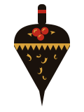

# Khokhloma 金地彩繪 хохломская роспись

## 設計哲學

Khokhloma 是伏爾加河中游（今下諾夫哥羅德州 Koverninsky 區的 Khokhloma 村，及後來的工業中心謝苗諾夫 Semyonov）的木器彩繪，十七世紀下半葉出現；1659 年貴族 Morozov 給管家的信裡已經在訂「一百只用錫粉打亮的彩繪盤」。傳說是逃進森林的舊禮儀派（Old Believers）聖像畫師，教會了當地車木匠「不用真金畫出金色」的辦法。1920–30 年代畫師組成合作社（artel），1960 年代蘇聯在 Khokhloma 村旁建「Khokhloma 畫師」工廠、在謝苗諾夫建「Khokhloma 彩繪」聯合工廠，今天的碗、匙、干樂、家具幾乎都出自這兩處；謝苗諾夫工廠 1972 年起附設博物館，2008 年另有「Золотая хохлома」文化中心。

**它為什麼長成這樣**——整個風格是一道工序的結果，不是一個調色盤：

1. 木坯（椴木、白楊、樺木）在**車床**上車成，所以器物都是圓的，裝飾自然沿同心圓、沿碗沿一圈一圈排。
2. 抹泥漿（вапа）封孔 → 上亞麻仁乾性油（олифа）三到四次 → **擦一層錫粉**（今天是鋁粉）：此時整件器物是**銀色的**。
3. 用耐熱油彩只畫兩種顏色：**朱（硃砂）與黑（煙灰）**，松鼠毛筆，一筆成形不描不補。
4. 上清漆、**進窯烘烤**：清漆受熱變黃，底下的銀透過黃漆看起來就成了**蜂蜜色的金**。

所以：金永遠是**地**（大面積、不畫成線框），朱與黑是**畫在上面的筆觸**；另一種畫法「地畫法」фоновое письмо 則把背景全部塗黑、留下銀（烤後成金）的剪影。沒有第三種地，沒有第四種主色。

本 SKILL 把這套語言翻譯成網頁：**頁面本身就是那只碗**——金地是頁底、黑地是另一種段落、內容單位是會轉的圓。

## 本風格的 5 個不可省略特徵

拿掉任何一項，它就不再是 Khokhloma。

### ① 金地＝烤過的銀（大面積蜂蜜金為地，帶錫粉顆粒；銀是它的「未烤狀態」）

頁面 ≥45% 是金地 `#D7A13A`。金是平塗＋極細的深金顆粒（錫粉擦痕），**不是金屬漸層、不是反光貼圖**。需要表現「工序」時，用銀 `#BEC2C3` 表示未烤狀態，再「烤」成金。

```css
:root{--gold:#D7A13A;--gold-d:#B5802A;--silver:#BEC2C3}
body{background:var(--gold) url("data:image/svg+xml,%3Csvg xmlns='http://www.w3.org/2000/svg' width='240' height='240'%3E%3Cfilter id='n'%3E%3CfeTurbulence type='fractalNoise' baseFrequency='.85' numOctaves='1' seed='9' stitchTiles='stitch'/%3E%3CfeColorMatrix values='0 0 0 0 .62 0 0 0 0 .43 0 0 0 0 .12 7 0 0 0 -4.3'/%3E%3C/filter%3E%3Crect width='100%25' height='100%25' filter='url(%23n)'/%3E%3C/svg%3E")}
/* 盤：未烤＝銀與偏冷的覆盆子朱；烤過＝金與正朱 */
.disc{--dg:var(--gold);--dr:#C0281C;--dk:#1A120C}
.disc.raw{--dg:var(--silver);--dr:#AA305E}
```

### ② 朱與黑只畫在金上；或金從黑裡挖出來（верховое／фоновое 兩種地，沒有第三種）

只有朱 `#C0281C`、炭黑 `#1A120C`、金三色；葉綠 `#4F6B2A` 最多 3%（本站完全沒用）。**零漸層、零模糊陰影、零發光、零紙白。**黑地段落裡，金是字與圖、黑是地。

```css
.fon{background:#1A120C;color:#D7A13A}          /* фоновое 地畫法段落 */
.disc.fon-d{--dg:#1A120C;--dk:#D7A13A}          /* 同一套筆畫換成黑地金剪影 */
```

### ③ 草紋 травка：一筆成形的錐形筆觸——下筆圓重、往前拖、收筆尖並捲成鉤

所有植物都是這種筆：中心線以航向積分產生（`heading = a + bend·s + hook·s³`，越到尾端越捲），寬度輪廓 `w(t)=(1−t)^0.85`，起筆半圓帽。六種基本筆：травинка 草莖（捲鉤）、осочка 鋸草（細長）、капелька 水滴（短圓）、усики 捲鬚（一圈半）、завиток 捲草（粗 S）、кустик 草叢（同點五筆）。同一圈上筆向一致。

```js
function line(x,y,a,len,bend,hook,n){var p=[[x,y]],st=len/n;for(var i=1;i<=n;i++){var s=i/n,h=a+bend*s+hook*s*s*s;x+=Math.cos(h)*st;y+=Math.sin(h)*st;p.push([x,y]);}return p;}
function taper(p,w){/* 沿法線左右偏移 w*(1-t)^.85/2，起筆畫半圓帽，回傳 SVG path */}
// 草莖：len 40k、寬 10k、bend .6、hook 2.8；水滴：len 17k、寬 12k、bend .2
```

### ④ 漿果與 тычок 點：朱色正圓成串（3–7 顆），每顆左上壓三個小點；葉是兩端尖的黑水滴、葉脈是地色

```svg
<g><circle cx="0" cy="0" r="30" fill="#C0281C"/>
<circle cx="-10.5" cy="-11.4" r="6" fill="#D7A13A"/><circle cx="-.6" cy="-15" r="4.8" fill="#D7A13A"/><circle cx="-15" cy="-2.4" r="4.8" fill="#D7A13A"/></g>
```

тычок 原本是用棉花團或筆桿頭「戳」上去的點，永遠落在同一側（光的方向），不要隨機散佈。

### ⑤ 車木圓構圖：內容單位是會轉的圓——碗沿鋸齒帶＋同心環分區＋中心花心；字沿圓周排

碗沿一圈黑鋸齒（зубчики）夾兩道細線，內部依半徑分成數個環帶、每帶只放一種母題，中心是放射葉＋一串漿果。段落之間也用鋸齒帶分隔。圓周字用 SVG `<textPath>`。

```css
.rim{height:14px;background:url("data:image/svg+xml,%3Csvg xmlns='http://www.w3.org/2000/svg' width='24' height='14'%3E%3Cpath d='M0 0L12 14L24 0Z' fill='%231A120C'/%3E%3C/svg%3E") repeat-x 0 0/24px 14px}
```
```svg
<defs><path id="rimp" d="M-467 0A467 467 0 1 1 467 0A467 467 0 1 1 -467 0"/></defs>
<text font-size="31" font-weight="900"><textPath href="#rimp" textLength="2900">金干樂車木所・苗栗三義水美街・…</textPath></text>
```

## 色彩系統

| 角色 | hex | 用途 | 比例 |
|---|---|---|---|
| 金地 | `#D7A13A` | 頁底、盤地、黑地上的字 | 45–55% |
| 深金 | `#B5802A` | 錫粉顆粒、黑地上的分隔線 | ≤3% |
| 炭黑 | `#1A120C` | 草紋、鋸齒、段落地（фоновое）、正文 | 25–30% |
| 朱 | `#C0281C` | 漿果、價籤、主要強調 | 8–12% |
| 深朱 | `#8E1B13` | 金地上的小字強調 | ≤2% |
| 銀（未烤） | `#BEC2C3` | 只在「工序／尚未進窯」的狀態出現 | 依互動 |
| 覆盆子朱（未烤） | `#AA305E` | 未烤狀態的朱 | 依互動 |
| 葉綠 | `#4F6B2A` | 可選，只給葉 | ≤3% |

規則：朱絕不當大面積地；金不做成描邊；黑地段落與金地段落交替時中間一定隔一條鋸齒帶。

## 字體系統

- 中文：**Noto Serif TC** 500／700／900（Google Fonts）。標題 900、字距 .02–.12em；正文 500、16px／1.75。
- 拉丁／西里爾展示：**Ruslan Display**（俄式舊體展示字，只用在 12–26px 的標籤與品牌拉丁名，字距 .14–.22em）。
- 拉丁小字與註記：**PT Serif** italic（ParaType 為俄文公共字型計畫所做）。
- 字級：h1 64–128px（`clamp(64px,9vw,128px)`）、h2 30–60px、h3 20–24px、正文 16px、註 12–13px。
- 圓周字 31/1040 viewBox 單位、900。

## 版面與網格

- 版心 `min(1180px,100% - 32px)`；首屏兩欄 1.15fr／.85fr，左欄是一只大盤（≤680px），右欄品牌字。
- 段落順序交替：金地 → 鋸齒帶 → 黑地 → 倒置鋸齒帶 → 金地。
- 圓的大小承載資料（例：器物架上盤徑依真實直徑開根號縮放）。
- 零旋轉的矩形卡片；卡片若必要，用「整頁寬的黑地段落」或圓角 28px 的黑地單據，不做三欄卡片。
- 留白：段落上下 64–96px；圓與圓之間 ≥14px。

## 元件配方

- **導覽（一枝莓）**：右上一條錐形黑莖、四顆莓各一頁；未在的頁是金心黑圈（未熟），現用頁是朱色實心＋三個 тычок 點（熟了）。hover 時朱心長到 62%。≤760px 改成底部黑條四等分。
- **按鈕**：湯匙輪廓的膠囊 `border-radius:999px`，黑底金字 900；hover 朱底黑字；次要按鈕金底黑框 3px。黑地段落裡反轉成金底黑字。
- **價籤**：朱色膠囊，黑字 900。
- **表單**：膠囊輸入框，3px 黑框，金底；radio 用膠囊 chip，選中反黑。
- **單據**：黑地、圓角 28px、左上一個金色圓（放元件或盤）、表格只用 2px 深金底線。
- **頁尾**：黑地金字，頂上一條倒置金鋸齒帶。

## 動效規則

| 種類 | 本站實作 | 觸發 | 時間／曲線 | reduced-motion |
|---|---|---|---|---|
| ambient | 首屏大盤與器物架上的盤在車床上慢轉（`Element.animate` rotate 0→1turn，36 s／圈；架上 26–44 s） | 載入 | linear, infinite | 不轉，停在初始角度 |
| input | 拖住盤面轉它：拖曳＝直接 seek `currentTime`，放手後依角速度給 `playbackRate` 並以 2.5%／幀回到基速；架上滑過時 `updatePlaybackRate(9)`；草紋八筆滑過重畫一筆（650 ms） | pointer／focus | 慣性指數衰減 | 拖曳照常（使用者自己在動）；重畫停用 |
| transition | 換頁「圓幕」：黑地金花的圓從點擊處以 `clip-path: circle()` 張開（480 ms, cubic-bezier(.7,0,.25,1)），新頁收回（620 ms） | 點內部連結 | 同左 | 直接換頁 |
| signature | **進窯**：車床先停（`updatePlaybackRate(0)`），SVG 濾鏡 `feColorMatrix` 對角從單位矩陣插值到 (1.13, .83, .297)——銀 #BEC2C3 精確映成金 #D7A13A、覆盆子朱映成正朱；同時 `feTurbulence`＋`feDisplacementMap` 熱氣上升（scale 0→10→0、offset dy 0→−160）；2.6–3 s，ease-in-out；結束時移除濾鏡、換成金色變數 | 首頁載入 0.9 s 後、工序區捲到時、〈轉一顆〉按進窯 | 2600–3000 ms | 直接顯示金 |

自我限制：不用淡入當主打、不用數字計數、不用描線（dashoffset）動畫——筆觸是「長出來」的（逐段生成錐形輪廓），不是描出來的。

### motion-library 元件表（v1.12.0 @61e24ce，`tools/ml-embed.js` 子集＋`src/motion-player.js`）

| 頁 | ID | 名稱 | 參數 | 承載什麼／為什麼適合 | 類型 |
|---|---|---|---|---|---|
| 首頁 | TXT-B-16 | Circle Text | text `ХОХЛОМА`、colors primary `#C0281C` secondary `#1A120C` bg `#D7A13A`、duration 1.6、loop false、seed 1962、1:1 | 「碗底印記」：字先繞成一圈再轉正——謝苗諾夫工廠碗底的圈字章；圓周字正是特徵⑤ | transition（一次性） |
| 器 | BG-B-05 | Spiral Dots | primary `#C0281C` secondary `#1A120C` bg `#D7A13A`、duration 14、density 1.1、intensity .8、seed 45、16:9 裁成條 | 朱點以黃金角螺旋排開＝漿果與 тычок 點的田；全是正圓、無發光無漸層 | ambient |
| 轉 | BG-A-09 | Polar Grid | primary `#1A120C` secondary `#C0281C` bg `#D7A13A`、duration 9、density .9、seed 60、16:9 裁成條 | 同心圓由內往外推＝車床上木坯被刀走過的車紋，放在車床頁頂 | ambient |
| 轉 | TXT-A-22 | Orbit | text `出窯`、primary `#C0281C` secondary `#1A120C` bg `#D7A13A`、duration 1.5、loop false、seed 7、1:1 | 訂製單標題：字繞著圓軌道轉一圈再落定＝干樂轉完倒下 | transition（一次性） |
| 來 | BG-B-21 | Ripple Rings | primary `#D7A13A` secondary `#C0281C` bg `#1A120C`、duration 6、density .9、seed 286、16:9 裁成條 | 黑地上的金環一圈圈盪開＝干樂放在地上轉起來的同心色環；黑地金環就是 фоновое | ambient |

規則：每頁第一個 `<script>` 是子集；掛載走 `KK.ml`（等 `document.fonts.ready`、離屏 `destroy()`、一次性文字 `loop:false` 只播一次、canvas `aria-hidden`、容器內保留 `.ml-fb` HTML 標題、reduced-motion 背景 `seek(.35)`、文字 `seek(1)`）。元件不當 signature；同一畫面同時運轉 ≤2 個。元件庫的文字用其內建無襯線字，所以只放短字（西里爾 ХОХЛОМА、「出窯」），長文一律 HTML。出處：`MotionLib.prompt(id)`。

## 插畫與圖像風格

**草紋筆序生成（travka grammar）**：全站沒有一張圖檔。每件器物都是同一支生成器輸出的 SVG path：

1. 環帶 `ringStrokes(type,r0,r1)`：依周長決定件數（草 36、捲 84、叢 80、鋸齒 26、鱗 44、莓 118 單位間距），每件帶圓周角 `a`。
2. 每筆 `drawStroke` → 錐形輪廓 path，**依顏色合併成 3 條 `<path>`**（黑／朱／地色點與葉脈），一只盤 ≈ 60 KB path、生成 2.3 ms。
3. 花心 `rosette(r)`：六片放射葉＋七顆漿果。
4. 枝 `sprig()`：S 形主莖＋兩側交錯生草，可帶一串漿果（用在湯匙、地圖）。

禁止：寫實透視、陰影立體、描邊線稿、隨機散點的 тычок、把金畫成線。

## Logo 與 Favicon 設計指南

- Logo：一顆干樂的側影（黑身＝地畫法），肩上一圈金鋸齒、頂上三顆朱莓、錐身金草紋、黑鐵尖；`assets/logo.svg`，120×160。
- Favicon：inline SVG data URI——黑圓、金地圓、金鋸齒圈、三顆朱莓。
- 品牌字「金干樂」Noto Serif TC 900、字距 .12em；拉丁 `KIM KAN-LÓK` Ruslan Display。

## Do & Don't

- Do：金是地、朱黑是筆；每一圈一種母題；筆觸一筆成形、有粗細；漿果左上三點；段落之間鋸齒帶；把「工序」做成可看的狀態（銀→金）。
- Do：黑地段落用金字（不是白字）。
- Don't：金屬漸層、反光貼圖、發光、模糊陰影、紙白／米白底、藍紫色、emoji icon、Lorem ipsum、三張圓角卡片並排、「EST. 19xx」徽章、跑馬燈。
- Don't：把 Khokhloma 跟 Gzhel（白地藍畫）、Zhostovo（黑漆托盤上的寫實花束）、Palekh（黑漆微型畫）混在一起——那是三個不同的流派。
- Don't：畫火鳥（Жар-птица）當主角來湊「俄羅斯感」；本流派的本體是草與莓。

## 頁面骨架範例

```html
<header class="top"><a class="brand" href="index.html"><span><b>金干樂</b><small>KIM KAN-LÓK</small></span></a>
 <nav class="sprig" aria-label="主選單"><svg class="stem" aria-hidden="true"></svg>
  <a href="index.html" style="--x:40px;--y:32px" aria-current="page"><svg class="bb" viewBox="0 0 30 30"><circle class="o" cx="15" cy="15" r="12"/><circle class="f" cx="15" cy="15" r="12"/><g class="d"><circle cx="10.6" cy="10.4" r="2.3"/><circle cx="14.8" cy="8.8" r="1.8"/><circle cx="8.8" cy="14.2" r="1.8"/></g></svg><span>車</span><i>the lathe</i></a>
  <!-- 器／轉／來 同上 --></nav></header>
<main id="main">
 <section class="hero"><div class="lathe"><div class="disc raw"><div class="dg"></div><div class="spin"><svg viewBox="-520 -520 1040 1040"><path class="k" d="…"/><path class="r" d="…"/><path class="g" d="…"/></svg></div></div></div>
  <div class="hcopy"><h1>金干樂<small>車木所</small></h1><p class="lat">KIM KAN-LÓK TURNERY</p><a class="btn" href="tsuan.html">轉一顆</a></div></section>
 <div class="rim" aria-hidden="true"></div>
 <section class="fon">…黑地段落…</section>
 <div class="rim g up" aria-hidden="true" style="background-color:var(--gold)"></div>
</main>
<footer class="foot">…</footer>
```

## 技術實作與相容性

### 1. SVG 濾鏡鏈（A 渲染層）：`feTurbulence`＋`feOffset`＋`feDisplacementMap`＋`feColorMatrix`

- 承載：特徵①（錫粉顆粒）與 signature「進窯」。顆粒是 CSS 背景的 data-URI SVG（只柵格化一次）；進窯濾鏡以 CSS `filter:url(#bake)` 套在 `.disc` 上，只在 2.6–3 s 的動畫期間存在，結束後拿掉、改用金色 CSS 變數（避免每幀重算濾鏡）。進窯時車床先停，否則每幀都要重算濾鏡。
- 支援：MDN 標 `<feComponentTransfer>` 等 SVG 濾鏡原語為 Baseline Widely available（2015-07 起全瀏覽器）；SVG 濾鏡預設在 linearRGB 運算，本站以 `color-interpolation-filters="sRGB"` 讓矩陣直接作用在 hex 值上（銀 ×(1.13,.83,.297) ＝ 金）。
- Fallback：找不到 `#bake` 或 reduced-motion → 直接移除 `.raw`、顯示金。
- 查證：MDN feComponentTransfer（developer.mozilla.org/en-US/docs/Web/SVG/Reference/Element/feComponentTransfer）。

### 2. 草紋筆序生成器＋決定性 FNV-1a＋URL 狀態（E 資料與生成層）

- 承載：特徵③④⑤——全部圖像；〈轉一顆〉的筆序（每筆圓周角 `a`、以開始時筆刷所在角排序）、單號 `KKL-`＋FNV-1a base36、`?k=外.中.心&z=尺寸&n=刻字&o=rope,box` 分享並還原。
- 效能實測（Node 22）：一只完整盤 2.3 ms 生成、path ≈ 66 KB；頁面 169–180 KB（含 118 KB motion-library 子集），≤350 KB。
- Fallback：無 JS 時 `<noscript>` 給文字價目與電話。

### 3. Web Animations API 時間軸控制（B 動效與時間軸層）

- 承載：車床本身就是一個 `Element.animate()`（rotate 0→1turn、iterations Infinity）。**它的 `currentTime` 是盤面角度的唯一真相**：拖曳＝直接改 `currentTime`（seek），踩踏板＝`playbackRate=10`，放手慣性＝逐幀改 `playbackRate`，進窯前停車＝`updatePlaybackRate(0)`；〈轉一顆〉每幀讀 `currentTime` 算出角度差，只有順時針前進才讓固定在右側的筆刷落筆。旋轉是 HTML 包裝層的 transform，走合成器，不重畫 SVG。
- 支援：`Animation.updatePlaybackRate()` MDN 標 Baseline Widely available（2020-03 起）；caniuse：Chrome 76、Firefox 60、Safari 13.1、Edge 79。`playbackRate` setter 為同步、`updatePlaybackRate` 會先同步當前位置再換速（無跳格）。
- Fallback：不支援 `updatePlaybackRate` 時改用 `playbackRate` setter；reduced-motion 時基速 0（不自轉），拖曳照常。
- 查證：MDN Animation.updatePlaybackRate（developer.mozilla.org/docs/Web/API/Animation/updatePlaybackRate）、caniuse mdn-api_animation_updateplaybackrate。

### 附：SVG `<textPath>`

- 碗沿字。MDN 標 `<textPath>` 與 `startOffset` 為 Baseline Widely available（2015-07 起）。字在旋轉層裡跟著盤轉。

### 查證來源（風格）

- Wikipedia〈Khokhloma〉（1659 Morozov 信、舊禮儀派起源、兩種畫法、1960s 兩座工廠、1972 博物館、2008 Золотая хохлома）。
- Yemelyanova, Tatyana. *Khokhloma Folk Painting*. Leningrad: Aurora Art Publishers, 1980.
- Hilton, Alison. *Russian Folk Art*. Indiana University Press, 1995.
- 工序（泥漿、乾性油三四次、鋁粉、耐熱油彩、清漆入窯變黃）：jw.org〈A Traditional Form of Russian Wood Painting〉、gw2ru〈Khokhloma: All you need to know〉。烘烤溫度各來源說法不一，本站只寫「攝氏一百五十度上下」。
