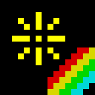

# ZX Spectrum 載入畫面・屬性色格 — 風格規格書

> 示範站：點火煙火 TIÁM-HUÉ（臺南鹽水的煙火製造與施放）。本規格與產業無關：遊戲工作室、唱片行、程式教室、夜市攤、獨立出版都能直接套用。

## 設計哲學

1982 年 Sinclair ZX Spectrum 只有 48KB（基本款 16KB）記憶體，畫面只撥得出 6,912 位元組：6,144 位元組是 256×192 的單色點陣（每位元組 8 個像素），另外 768 位元組是「屬性」——螢幕切成 32×24 個 8×8 格，每格一個位元組，寫著這格唯一的墨色 INK、紙色 PAPER、亮度 BRIGHT 與閃爍 FLASH。所以一格裡永遠只能有兩種顏色；兩個不同顏色的東西走進同一格，後到的會把整格染成自己的顏色——這叫 attribute clash（屬性衝突／撞色）。

磁帶載入時，ROM 把卡帶訊號直接映到邊框：導引音是一條條粗的紅／青橫紋，資料段變成細碎的藍／黃橫紋；畫面依記憶體位址順序一條條掃出來——不是由上往下，而是每個三分之一裡先畫每一字元列的第 0 條掃描線、再第 1 條……最後顏色一次灌進來。整整一代人看著這個順序等遊戲。

本風格的核心不是「像素復古」，而是**限制被看見**：格子、兩色、撞色、位址順序。設計師要做的是把這些限制當成構圖規則，而不是假裝它們不存在。

## 本風格的 5 個不可省略特徵

### 1. 8×8 屬性格：一格只准兩色，撞色要被看見

每一個圖像元素都落在 8px 格網上；同一格只能一個 INK＋一個 PAPER。兩色重疊時不做混色、不做透明——後畫的整格勝出，留下方塊狀的色邊。這是本風格最強的辨識點，拿掉它就只是「像素風」。

```js
// 寫入像素時順便改寫所在格的 INK＝撞色
plot(x,y,ink,bright){
  this.bm[y*32+(x>>3)] |= 128>>(x&7);
  const ci=(y>>3)*32+(x>>3), a=this.at[ci];
  this.at[ci]=(a&0xB8)|(ink&7)|(bright?64:0);   // 保留 PAPER/FLASH，換 INK/BRIGHT
}
```

### 2. 固定 15 色：#D7 一般＋#FF BRIGHT，零漸層零透明

八色（黑、藍、紅、洋紅、綠、青、黃、白）各有一般（215）與 BRIGHT（255）兩階，黑只有一個。任何地方都不准出現第 16 色、半透明、模糊陰影或漸層（唯一例外：用硬色標做出的條紋）。灰只能是 `#D7D7D7`（一般白）。

```css
:root{--k:#000;--b:#0000D7;--r:#D70000;--m:#D700D7;--g:#00D700;--c:#00D7D7;--y:#D7D700;--w:#D7D7D7;
 --B:#0000FF;--R:#FF0000;--M:#FF00FF;--G:#00FF00;--C:#00FFFF;--Y:#FFFF00;--W:#FFFFFF}
```

### 3. 邊框 BORDER：畫面永遠是框中之窗，載入時邊框變磁帶條紋

256×192 的螢幕永遠被一圈實心邊框包著；網頁上「頁面底色＝邊框色」，內容是窗。載入或換頁時，邊框變成隨機高度的紅／青粗條（導引音），再變成細碎的藍／黃條（資料）。

```js
function stripes(el,data){const cols=data?['#0000D7','#D7D700']:['#D70000','#00D7D7'];let y=0,s=[];
 for(let i=0;i<16;i++){const h=data?2+Math.random()*9:12+Math.random()*30;s.push(`${cols[i%2]} ${y}% ${y+h}%`);y+=h;}
 el.style.background=`linear-gradient(180deg,${s.join(',')})`;}   // 硬色標，每幀重抽
```

### 4. 載入順序：三分之一 → 掃描線 → 字元列，顏色最後一次灌入

圖像出場一律照真機顯示檔位址：螢幕分三個 64 列的區塊；每區塊先畫 8 個字元列的第 0 條掃描線，再第 1 條……；點陣全部到齊後，屬性（顏色）才由上往下一格一格染進去。在那之前畫面是白紙黑墨。

```js
const addr=(x,y)=>((y&0xC0)<<5)|((y&7)<<8)|((y&0x38)<<2)|(x>>3); // 真機位址
const order=[...Array(192).keys()].sort((a,b)=>((a>>6)-(b>>6))||((a&7)-(b&7))||(((a>>3)&7)-((b>>3)&7)));
// 第 n 幀只顯示 order[0..n) 的掃描線；未載入的屬性用 0x38（白紙黑墨）
```

### 5. 8×8 等寬點陣字＋一鍵關鍵字＋四色斜紋

文字在 32 欄格網上，全大寫 BASIC 語氣（`LOAD ""`、`RUN`、`0 OK, 0:1`、`C Nonsense in BASIC`）；游標是一格反白、會 FLASH 的 K／L。導覽與按鈕就是橡膠鍵：字母在鍵上、關鍵字印在下方。唯一的裝飾母題是紅黃綠青四條斜紋。中文標題以 16px 光柵化成 1-bit 再整數倍放大。

```css
.rainbow{width:96px;height:56px;background:linear-gradient(118deg,#000 0 34%,#D70000 34% 47%,#D7D700 47% 60%,#00D700 60% 73%,#00D7D7 73% 86%,#000 86%)}
.zxt{image-rendering:pixelated;image-rendering:crisp-edges}
```

## 色彩系統

| 色 | hex | 用途 | 比例 |
|---|---|---|---|
| 邊框色（每頁一色） | 首頁 `#0000D7`／型錄 `#D700D7`／寫一場秀 `#000000`／來店 `#00D7D7` | 頁面底＝螢幕邊框 | 35–45% |
| 白紙 | `#D7D7D7`、`#FFFFFF` | 內容紙面、編輯器 PAPER | 25% |
| 黑 | `#000000` | 螢幕 PAPER、鍵盤銘板、頁尾 | 20% |
| BRIGHT 原色 | `#FF0000 #FFFF00 #00FF00 #00FFFF #FF00FF #0000FF` | 煙火、狀態、強調、色塊 | ≤10% |
| 橡膠灰 | `#5A616B` | 鍵帽（唯一的非 Spectrum 色，代表實體鍵） | ≤3% |

規則：深色邊框配白字（`#FFFFFF`），青、黃、白邊框配黑字；長文只放在白紙或黑紙上，不直接壓在彩色邊框。一個區塊最多一個 BRIGHT 色當主角。

## 字體系統

- **Silkscreen**（Google Fonts 400／700）：標籤、鍵帽、行號、報告列。12px／9px（鍵上關鍵字）／16px（行號），全大寫、字距 .04em。
- **Noto Sans TC**（500／700／900）：內文 16px／1.75；小標 20–26px／900。
- **螢幕內**：原創 5×7 字形放在 8×8 格（第 1–7 列、第 1–5 欄），只用大寫與數字。
- **中文像素標題**：`data-zx` 元素在 `document.fonts.ready` 後以 16px Noto Sans TC 700 畫進 canvas、alpha>118 判為 1，寬度補到 8 的倍數，再以 3–5 倍 `pixelated` 放大；原文字保留在 `.sr` 給讀屏。

字級階：12 / 16 / 20 / 26 / 32（HTML）＋像素標題 48 / 80（=16×3 / 16×5）。

## 版面與網格

- 基本單位 8px；所有間距 8 的倍數（16／24／32／40／56）。零圓角、零旋轉。
- 首頁：左 1.25fr 為「電視」（黑邊框＋4:3 canvas），右 1fr 為白紙文字欄。≤900px 疊成單欄。
- 螢幕 canvas 一律原生 256×192（或 8 的倍數小圖），CSS 寬 100%＋`image-rendering:pixelated`，不准非整數平滑縮放的模糊感。
- 內容區塊左緣 8px 的藍／黃磁帶條（`.ld::before`），表示「這塊是載入進來的」。

## 元件配方

- **導覽（鍵帽）**：黑色銘板上四顆 64×56 橡膠鍵，`box-shadow:0 4px 0 #2A2E33` 是行程；hover 沉 2px、現用頁沉 4px 並反白（白鍵黑字＝反相視訊）。鍵下紅字中文頁名，現用頁轉黃。實體鍵 J／P／R／G 直接換頁。
- **按鈕**：黑或 BRIGHT 黃方塊，左側一個 `<kbd>` 反白小格寫按鍵；`:active` 沉到底、陰影歸零。
- **卡片**：白紙＋上方鍵帽＋小螢幕（96×72＝12×9 格）＋四欄 `dl` 規格以 2px 黑線分隔。
- **清單**：黑底 BASIC 清單，行號 10、20、30 用 BRIGHT 黃。
- **表單**：白底 2px 黑框、零圓角；錯誤訊息用 Spectrum 報告語（`2 Variable not found`），成功是 `0 OK, 10:1`。
- **頁尾**：黑底、青色小標、黃色連結、最後一列是建置模型。

## 動效規則

| 種類 | 本站實作 | 觸發 | 時間 | 降級 |
|---|---|---|---|---|
| ambient | 首頁螢幕：FLASH 屬性每 0.32 秒反相（真機 16 幀/50Hz）；每 1.4–2.3 秒自動一發煙火；營業中方塊 `steps(1)` 閃 | 時間 | 25fps 固定拍（40ms） | 停在完成畫面、不閃 |
| input-driven | 點螢幕任一處 → 在該處 8 幀內升空開花；鍵帽 hover/按下沉入；型錄卡片 hover/focus 播放該彈種；〈寫一場秀〉每一鍵立即重繪 | pointer / key | <40ms | 點螢幕直接畫出開花的單一影格 |
| transition | 換頁：整個視窗變成紅／青導引音條紋 300ms → 藍／黃資料條紋 220ms → 換頁；新頁以藍／黃條紋 `clip-path` 每 30ms 收 8% 退場 | 點鍵帽或按 J/P/R/G | 520ms＋400ms | 直接換頁 |
| signature | **位址順序載入**：首頁與地圖螢幕依真機顯示檔位址逐條掃描線出現，最後屬性一次灌色；邊框同步磁帶條紋；任意鍵跳過 | 頁面載入／地圖捲入視窗 | 首訪 0.8+2.6+0.52 秒，再訪 0.3+1.1+0.26 秒 | 直接顯示完成畫面 |
| scroll | `.ld` 區塊以 `animation-timeline:view()` 由上而下 `steps(12)` 逐列出現，左緣條紋 `steps(24)` 走動 | 捲動 | entry 0%→cover 35% | 直接顯示 |

自我限制：禁用淡入、禁用 ease 曲線補間；所有動態用 steps 或固定拍。

### motion-library 元件表

來源：`wenxiangxiao/motion-library` v1.9.0 @6e9435f（`tools/ml-embed.js` 子集＋`motion-player.js`），每頁 inline 為第一個 `<script>`；掛載走站內 `ZX.ml()`（等字型、離屏 destroy、一次性元件 `once`、reduced-motion 背景 `seek(.35)`／文字 `seek(1)`）。元件提示詞可用 `MotionLib.prompt(id)` 取得。

| ID | 名稱 | 頁 | 參數 | 承載什麼／為什麼適合 | 動效類 |
|---|---|---|---|---|---|
| TXT-B-27 | Pixel Dissolve | index | text「上檔 ON TONIGHT」、primary #FFFF00、secondary #FF0000、bg #000000、duration 2.2、once、seed 1984 | 檔期標題由方格像素溶出——方格正是屬性格的語彙，全 `fillRect` 零圓角零發光，黑底字色自動近白 | transition |
| BG-B-22 | Stripe Twist | index | primary #D70000、secondary #00D7D7、bg #000、duration 6、density 1.4、seed 61 | 兩段之間一條紅／青扭動條帶＝導引音邊框的長版；只畫矩形 | ambient |
| TXT-B-30 | Checker Words | shells | text「型錄 CATALOGUE」、primary #D700D7、secondary #000、bg #D7D7D7、duration 2、once、seed 6 | 棋盤格長出後挖出字——棋盤是 Spectrum 唯一的「混色」手段（點陣抖動）；白紙底字色自動近黑 | transition |
| TXT-A-27 | Typewriter | program | text「10 REM 寫一場秀」、primary #00FF00、bg #000、duration 2.4、once、seed 10 | 逐字打出一行 BASIC REM 與方塊游標，正是編輯器的語氣 | transition |
| BG-B-18 | Horizontal Lines | visit | primary #D70000、secondary #00D7D7、bg #000、duration 5、density 1.2、seed 254 | 水平紅／青條紋流動＝導引音載入時的邊框，放在「來店」頁首當 LOAD 待機 | ambient |

同一畫面同時運轉的元件不超過 2 個；元件不擔任 signature。

## 插畫與圖像風格

所有圖像都是**屬性格點陣**：以 PLOT／DRAW（Bresenham）／CIRCLE（中點圓）／FILL 畫進 1-bit 點陣，再指定每格 INK/PAPER。場景用「黑紙＋白線剪影」為底（街屋、燕尾脊廟頂），彩色只給主角（煙火、水面倒影），讓撞色只發生在你想讓人看見的地方。水面＝藍紙青墨；田＝綠紙；旗標格＝ FLASH。煙火是粒子：每顆星每幀 `plot()`，尾巴是前幾幀位置；長曝光＝把每幀點陣 OR 起來、屬性取最後一次寫入。不准使用任何外部圖片。

## Logo 與 Favicon 設計指南

16×16 點陣、黑底：左上一朵十六點的 BRIGHT 黃煙火（中心＋十字三格＋斜向兩格），右下四色斜紋（紅、黃、綠、青各兩條像素對角線）。SVG 以 `<rect width=1 height=1>` 拼成、`shape-rendering="crispEdges"`；favicon 用同一份 SVG 的 data URI。放大只准整數倍。

## Do & Don't

- Do：讓撞色出現在畫面上（至少一處）；Don't：用透明或混色假裝兩色能共存。
- Do：每頁換一個邊框色；Don't：把文字長段落直接壓在彩色邊框上。
- Do：錯誤訊息用 Spectrum 報告語，讓失敗也有風格；Don't：用通用 toast。
- Do：載入順序照真機位址；Don't：由上往下的普通揭示（那就只是 wipe）。
- Don't：CRT 掃描線、發光、曲面暗角（那是 CRT 磷光風）；Don't：Teletext 的 2×3 馬賽克塊與雙倍高字（那是圖文電視）；Don't：NES 式可任意上色的精靈（那是 8-bit 像素）。
- 去AI化：禁紫藍漸層、禁置中三卡片、禁 emoji icon、禁 Lorem ipsum、禁「EST. 19xx」徽章。

## 頁面骨架範例

```html
<body style="background:#0000D7">
<header class="plate"><div class="wrap">
 <a class="brand" href="index.html"><span class="lbl"><b>店名</b><span>ENGLISH NAME</span></span></a>
 <ul class="keys"><li><a href="index.html" data-key="J" class="on" aria-current="page"><span class="cap"><b>J</b><i>LOAD ""</i></span><span class="tcn">首頁</span></a></li>…</ul>
 <div class="rainbow" aria-hidden="true"></div>
</div></header>
<main>
 <section class="hero wrap">
  <div><div class="tv" id="tv"><canvas class="scr" width="256" height="192" role="img" aria-label="畫面描述"></canvas></div>
   <p class="report"><span>PROGRAM: NAME</span><span>任意鍵跳過</span></p></div>
  <div class="paper"><h1 data-zx="店名" data-scale="5">店名</h1><p>…</p></div>
 </section>
 <article class="paperW ld">…</article>
</main>
</body>
```

## 技術實作與相容性

1. **Canvas 2D ImageData＋型別陣列顯示檔**（A 渲染層）：`Uint8Array(6144)` 點陣＋`Uint8Array(768)` 屬性，每幀轉成 `Uint32Array` 寫進 `ImageData` 再 `putImageData`，CSS `image-rendering:pixelated` 放大。Canvas 2D／ImageData 為全瀏覽器基線支援。實測（node，同演算法）整幀轉換 0.24ms；瀏覽器 25fps 固定拍，CPU 佔用極低。位元組序以 `Uint32Array([1])` 偵測，大端機也正確。無 canvas 時：`role="img"` 的 aria-label 描述畫面，所有資訊另有 HTML 文字。
2. **CSS scroll-driven animations `animation-timeline: view()`**（B 動效層）：`.ld` 區塊逐列出現與左緣條紋走動。查證：Chrome／Edge 115 起預設支援；Safari 26（2025-09）支援；Firefox 152（2026-06）stable 仍在 `layout.css.scroll-driven-animations.enabled` 旗標後（來源：caniuse 引述全球約 82.6%、buildmvpfast.com〈CSS Scroll-Driven Animations Go Cross-Browser〉2026）。偵測 `CSS.supports('animation-timeline: view()')`：不支援時改由 IntersectionObserver 加 `.in` 播放 0.72s `steps(12)`；無 JS 時 `.ld` 不隱藏；reduced-motion 全部直接顯示。
3. **鍵盤為主要操作：一鍵關鍵字**（D 輸入層）：`keydown` 的 `KeyboardEvent.key`（全瀏覽器支援）。K 模式下字母＝彈種、R＝RUN、A＝NEW；L 模式下數字＝顏色／位置；Backspace／Delete＝DELETE；全站 J／P／R／G 換頁（輸入框聚焦時不攔）。觸控裝置用螢幕上的橡膠鍵盤，`button` 元素，鍵盤 Tab 可達。
4. 位址順序與磁帶條紋查證：Spectrum 顯示檔 $4000–$57FF、屬性 $5800–$5AFF、三分之一內逐 8 列交錯（spectrumcomputing.co.uk〈Spectrum Memory〉、Wikipedia〈Attribute clash〉）；導引音紅／青、同步後 ROM 反轉低位元變藍／黃（worldofspectrum.net〈Spectrum ROM Load Routine〉、k1.spdns.de〈tapeloader in rom〉）。
5. **效能預算**：四頁各 121–129KB（含 motion-library 子集 84KB），遠低於 350KB；首屏 JS 僅建顯示檔與一次 putImageData（<10ms）；動畫 25fps 固定拍且離屏暫停（IntersectionObserver＋visibilitychange）；同畫面運轉元件 ≤2。
