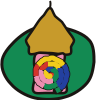

# Hundertwasser 有機螺旋建築 Hundertwasser Organic Architecture — Window Right & Tree Tenants

> 範例站：`sites/tshiu-tshu-kheh`（樹厝客 屋頂綠化工程行，新北三重〔品牌虛構〕）。
> 型錄位置：「繪畫與材質」新增條目，全館第 1 站。視覺家族 F3 裝飾繁複。

## 一、設計哲學

Friedensreich Hundertwasser（1928–2000）是畫家出身的維也納藝術家。1958 年他在 Seckau 修道院宣讀〈發霉宣言 Verschimmelungsmanifest〉：「直線是無神的、不道德的」，並主張出租公寓的住戶「必須可以從窗戶探出身子，在手搆得到的範圍內把外牆刮掉，用長刷子把搆得到的地方漆成粉紅色」。1972 年他為電視節目〈Wünsch dir was〉做了第一批建築模型，提出**森林屋頂、樹房客（Baummieter）與窗戶權（Fensterrecht）**；1973 年米蘭三年展在 Via Manzoni 的公寓窗戶種進約十五棵「樹房客」。1983–85 年，維也納百水公寓（Hundertwasserhaus，與建築師 Josef Krawina、規劃 Peter Pelikan 合作）落成：波浪樓板、覆土草頂、從房間長出窗外的樹，共 53 戶、約 250 棵樹與灌木。

這套語言在網頁上的意義是：**版面不是被網格切出來的盒子，而是一棟住著人的、會長的房子。**每個區塊都可以不一樣、可以歪、可以被住戶上色；唯一不允許的是直線與千篇一律。

使用時機：生活、居住、園藝、手作、兒童、在地社區、永續與修繕類品牌；任何想說「這裡的每個人都不一樣」的網站。不適合：金融儀表、法律文件、需要極高資訊密度的表格頁（可用，但要接受框線是波浪）。

## 二、本風格的 5 個不可省略特徵

### 特徵 1：零直線（形狀語彙）
畫面上找不到一條直線——框、按鈕、表格分隔、樓板、窗框、甚至文字基線都在波動。拿掉它，就只是一個「顏色很多的網站」。

```css
/* 框線放在 ::before，掛 SVG 位移濾鏡；文字本身不動，永遠可讀 */
.fr{position:relative;isolation:isolate;--bg:#F3EDE0;--rad:34px 20px 40px 16px/22px 38px 18px 34px}
.fr::before{content:"";position:absolute;inset:0;z-index:-1;background:var(--bg);
  border:3px solid #1A1612;border-radius:var(--rad);filter:url(#wob)}
```
```html
<svg width="0" height="0" style="position:absolute" aria-hidden="true"><defs>
 <filter id="wob" x="-5%" y="-5%" width="110%" height="110%">
  <feTurbulence type="fractalNoise" baseFrequency=".018" numOctaves="2" seed="7" result="n"/>
  <feDisplacementMap in="SourceGraphic" in2="n" scale="7" xChannelSelector="R" yChannelSelector="G"/>
 </filter></defs></svg>
```
畫布類元件（canvas）一律用不規則 blob 的 `mask-image`（SVG data URI）裁切，表格行線改成 `repeat-x` 的波浪 SVG 背景。

### 特徵 2：多色螺旋，色段長短不一、黑線打底（裝飾母題）
螺旋是百水反覆回到的母題，一圈繞著一圈像年輪一樣長（〈224 Der große Weg〉1955，158×158 cm，維也納 Belvedere 藏）。做法：先描一條粗黑螺旋，再在上面一段一段換色，**段長隨機、顏色不重複相鄰**，黑邊露出來就是色帶之間的分隔。

```js
/* G.spiralBands(cx,cy,turns,gap,colors,width,amp,seed) → SVG 字串（見站內 geo.js） */
out='<path d="'+spiral+'" stroke="#1A1612" stroke-width="'+(w+1.6)+'" fill="none"/>';
while(i<N){var len=6+Math.floor(r()*14);out+='<path d="'+seg(i,i+len)+'" stroke="'+cols[k++%cols.length]+'" stroke-width="'+w+'" fill="none"/>';i+=len;}
```

### 特徵 3：每扇窗都不一樣＋窗戶權的一臂色暈（版面手法）
同一頁上的「窗」（卡片、圖框、按鈕群）形狀、框色、大小都不同：拱、洋蔥、圓、斜、水滴、高瘦、歪方。每扇住了人的窗外，有一圈「手搆得到」半徑的色暈——是住戶自己上的顏色。

```js
G.winShape('onion',x,y,w,h,seed)   // arch / onion / round / lean / drop / tall / quad
halo = G.blob(cx,cy+4,w*.86,h*.78,.14,seed,11)   // 一臂之內的色暈，入住時 scale 0→1 帶回彈
```
```css
.roster{display:grid;grid-template-columns:repeat(6,1fr)} .rc0{grid-column:1/4}.rc1{grid-column:4/7;margin-top:60px}
.rc2{grid-column:1/3}.rc3{grid-column:3/5;margin-top:-30px}.rc4{grid-column:5/7;margin-top:40px} /* 不等寬、不對齊 */
```

### 特徵 4：樹房客、草頂與金色洋蔥頂（裝飾母題）
樹從窗裡長出來、傾出窗外；屋頂是一座有草的小山；山上站著金色、帶紅條紋的洋蔥頂。樹由 L-system 生成（每棵都不同），不用圖庫插畫。

```js
G.TREES.tsit={ax:'X',rules:{X:'F[+X]F[-X]+X',F:'FF'},gen:4,ang:24,len:3.1,leaf:'#1D6B36',fl:'#FFFDF4'}
var tr=G.grow('tsit',seed,lean); el.innerHTML=G.treeSVG(tr,progress,scale);
```
```css
/* 導覽的洋蔥頂：@property 讓 conic-gradient 的起始角能被補間 */
@property --spin{syntax:'<angle>';inherits:false;initial-value:0deg}
.cap{clip-path:path('M32 4C38 12 44 18 52 28C60 38 60 50 52 58L12 58C4 50 4 38 12 28C20 18 26 12 32 4Z');
 background:repeating-conic-gradient(from var(--spin) at 50% 72%,#D3342B 0 15deg,#F3EDE0 15deg 30deg);animation:spin 22s linear infinite}
@keyframes spin{to{--spin:360deg}}
.cur .cap{background:linear-gradient(115deg,#8E6A16,#C79A2B 28%,#F6E4A2 46%,#C79A2B 60%,#7C5B12)} /* 現用頁＝金箔 */
```

### 特徵 5：飽和平塗樓帶＋磁磚柱＋跳動的手寫字（色彩規則＋字體選擇）
立面是一條一條不同顏色的水平樓帶（粉、灰泥白、檸檬黃、鎘紅），樓帶之間是波浪黑線；兩側是不規則棋盤的陶磚柱；金色只出現在洋蔥頂與現用頁。字是手寫感、基線會跳：英文用 Shantell Sans 的 `BNCE` 彈跳軸，中文用霞鶩文楷並逐字加上不同的位移與旋轉。

```css
h1,h2{font-family:"Shantell Sans","LXGW WenKai TC",cursive;font-weight:800;font-variation-settings:"BNCE" 90,"INFM" 100}
.bt span{display:inline-block;transform:translateY(calc(var(--j)*1em)) rotate(calc(var(--r)*1deg))}
/* 建置期把每個中文字包成 <span style="--j:-.06;--r:2.3"> */
```

## 三、色彩系統

| 角色 | hex | 用途 | 約占比 |
|---|---|---|---|
| 灰泥白 | `#F3EDE0` | 頁面底、框內底、樓帶之一 | 34% |
| 墨 | `#1A1612` | 所有輪廓、正文 | 9% |
| 天 | `#CFE6EC` | 首屏天空、窗內玻璃（名冊） | 12% |
| 粉紅 | `#EE8FB1` | 窗戶權色暈、樓帶、宣言區 | 10% |
| 檸檬黃 | `#F2CC1B` | 樓帶、選取態、租約區 | 8% |
| 鎘紅 | `#D3342B` | 地面層、價格、現用頁標籤 | 6% |
| 群青 | `#2340A0` | 大路區底、窗框、磁磚 | 6% |
| 翠綠 | `#138A52` | 門、窗框、磁磚 | 5% |
| 草綠 | `#7DBA3A` | 屋頂草坡、頁尾地面 | 6% |
| 金 | `#C79A2B`／`#E8C86A` | 洋蔥頂、現用頁金箔 | 2% |
| 玻璃夜藍 | `#22305E` | 空窗的玻璃 | 2% |

規則：大面積只能是平塗；**唯一的漸層是金箔**（金屬光澤）。相鄰色帶不同色。不得出現紫藍漸層。

## 四、字體系統

- 標題：**Shantell Sans**（Google Fonts，可變軸 wght 300–800、BNCE −100–100、INFM 0–100），中文退至 **LXGW WenKai TC**。
- 內文：**LXGW WenKai TC** 400／700，17px，行高 1.8。
- 字級：品牌 clamp(64px,10vw,128px)／H2 40–44px／H3 30px／內文 17px／註 13–14px。
- 跳動：中文標題逐字 `--j`（±0.09–0.12em）與 `--r`（±3.5°），種子固定，所以每次載入一樣。

## 五、版面與網格

- 不用等欄網格：首屏 1.25fr：0.75fr（立面：說明）；名冊 6 欄但每張卡跨欄不同、上下錯位 −30～+60px。
- 區塊之間一律用**波浪分隔帶**（SVG `wline`，高 46px，振幅 ±32%，黑色 3px 描邊）換底色，不用水平直線。
- 卡片微旋 −1.4°～+1°；留白不規則，最小 14px（≤560px）。
- 固定元素：左上門牌（rotate −1.4°）、右下洋蔥頂導覽（坐在一座草丘上）。

## 六、元件配方

- **門牌（logo 區）**：`.plq.fr`，檸檬黃底，hover 轉到 +1° 並放大 3%。
- **導覽**：三座洋蔥頂（立面／屋頂／房客），每座條紋顏色不同、以 `--spin` 慢轉；現用頁是金箔＋一面紅旗、標籤紅底白字；hover 上浮 8px 並轉快。≤560px 落成整條底部草丘。
- **按鈕**：`.btn.fr`，手寫字 700，背景檸檬黃，hover rotate(−2°)。
- **選擇鈕（樹房客）**：44px 的 L-system 小樹＋名稱＋需求；`aria-pressed` 切換，選中變檸檬黃。
- **表格**：無格線，行下方是 60×8 的波浪 SVG `repeat-x`；價格欄用 Shantell Sans 800 紅字。
- **footer**：草綠地面，上緣波浪，三欄（地址／三頁／說明）。

## 七、動效規則（四種，缺一不可）

| 種類 | 本站自製實作 | 觸發／時長／easing | reduced-motion |
|---|---|---|---|
| ambient 環境 | 導覽洋蔥頂條紋以 `@property --spin` 22s 線性旋轉；立面洋蔥頂條紋 14s 旋轉；牆上螺旋 40s 反轉；樹房客 6.5–9s `sway` ±1.7°；營業狀態依臺北時間每 30 秒改寫 | 自動 | 全部停格，樹與螺旋保留最終形 |
| input 輸入 | **窗戶權粉紅刷**：游標在任一扇窗 90 單位（一臂）之內，就在 canvas 上刷出粉紅／黃的不規則色點（multiply），7 秒內慢慢「乾掉」；剖面 hover 指認土層；大路站點與步驟互相點亮 | pointermove，同幀回饋 | 刷色不乾（資訊無損） |
| transition 轉場 | **同心色環 iris**：點內部連結，從點擊處長出 12 色同心圓環（`repeating-radial-gradient`），以 `@property --reach` 補間 mask 半徑 0→160vmax（.62s cubic-bezier(.7,0,.25,1)），下一頁再從中心收回（.7s） | 點擊 | 不播放，直接換頁 |
| signature 簽名 | **樹房客入住**：合得來時，L-system 樹依「深度＋在主幹上的順序」排程，一段一段由根往梢長出（每段 ease-out cubic），梢頭葉片彈開，窗外一臂色暈 scale 0→1 帶三次回彈（2.6s）；合不來時只長到三成就垂頭 38°、淡出回苗圃（1.3s＋0.9s） | 選窗＋選樹 | 直接畫出定稿或直接顯示「合不來」訊息 |

自我限制：**本站不使用描線動畫（stroke-dashoffset）與淡入當主打**——樹是長出來的，不是被描出來的。

### motion-library 元件（PLAYBOOK §2.8）

來源：motion-library 1.33.0 @41128f85，`tools/ml-embed.js` 逐頁抽子集、terser `-c -m` 壓到每頁約 159KB，`tools/ml-smoke.js` 皆 smoke ok。開發 Prompt 見 `MotionLib.prompt(id)`。

| ID | 名稱 | 頁 | 參數 | 種類 | 承載什麼／為什麼適合 |
|---|---|---|---|---|---|
| BG-A-11 | Parallel Curves | index | colors {primary #138A52, secondary #D3342B, bg #EE8FB1}・duration 9・density 1.2・intensity 1.1・seed 1958・1:1 | ambient | 一束緩慢起伏的平行曲線＝百水立面的波浪樓帶；全是曲線、零直線零發光，符合特徵 ①⑤ |
| TXT-B-09 | Wave Letters | index | text「沒有一條直線」・primary #D3342B・secondary #2340A0・bg #EE8FB1・2.4s・loop false | transition | 每個字沿正弦波上下，基線本身在動＝〈發霉宣言〉的「直線是無神的」；粉底→近黑字 |
| BG-B-05 | Spiral Dots | roof | primary #C79A2B・secondary #D3342B・bg #2340A0・12s・seed 1973・1:1 | ambient | 黃金角螺旋的金點在群青上轉＝百水的金箔與螺旋；只有圓點，符合特徵 ② |
| TXT-B-33 | Text Spiral | roof | text「一條大路」・primary #D3342B・secondary #138A52・bg #F2CC1B・2.2s・loop false | transition | 字沿螺旋飛進定位＝施工七站排在一條螺旋大路上 |
| TXT-A-10 | Follow Path | tenants | text「樹房客名冊」・primary #138A52・secondary #D3342B・bg #F3EDE0・2.6s・loop false | transition | 字沿一條波浪小路走進來，路慢慢被拉平成字——像樹房客沿樓梯間被搬進窗 |
| BG-B-31 | Blob Shapes | tenants | primary #138A52・secondary #F2CC1B・bg #EE8FB1・10s・seed 1985・1:1 | ambient | 三到五塊會呼吸的不規則色塊＝窗戶權的一臂色暈；無邊無角 |

讀過原始碼後排除：全部 SHP（`softGrid()` 會畫 6% 的直線格線，違反特徵 ①）、BG-B-21 Ripple Rings（逐像素打光的寫實水面，與平塗衝突）。掛載：`document.fonts.ready` 之後才掛、離屏 `destroy()`、一次性文字 `once`、canvas `aria-hidden`、容器保留 `.ml-fb` 原文字；容器以 blob `mask-image` 裁切，不露出方角。同屏運轉 ≤2 個。

## 八、插畫與圖像風格

- 全站零圖檔。立面、剖面、螺旋大路、名冊窗框全部是建置期以 `geo.js` 輸出的 SVG：每條邊都是 Catmull-Rom 曲線穿過抖動點。
- 輪廓一律墨色 2–3.5px、圓頭；填色平塗；樹枝用咖啡 `#3B2618` 依深度遞減粗細（×0.66／層）。
- 樹：L-system（七里香／桂花／檸檬／羅漢松／雞蛋花各一套規則），葉是彎月形、花是小圓，羅漢松用三叉針葉。

## 九、Logo 與 Favicon

一座草丘上的金色洋蔥頂，下方一扇粉紅窗，窗裡一圈小螺旋。全部是抖動曲線，墨色 2.5–3px 輪廓；favicon 直接以同一份 SVG 做 data URI。

## 十、Do & Don't

- Do：讓每個重複元件長得不一樣；讓樹與植物真的從介面裡長出來；顏色平塗、相鄰不同色；文字永遠清楚（濾鏡只掛框線）。
- Do：把功能也做成建築隱喻（窗、樓層、屋頂、房客、租約）。
- Don't：任何直線（hr、table border、方形 canvas、直角卡片）；等寬三欄卡片；紫藍漸層；emoji 當 icon；Lorem ipsum；把 Hundertwasser 的作品直接複製進畫面（本站立面為原創）。
- Don't：為了熱鬧把濾鏡掛在正文上——會糊；也不要整片 feTurbulence 動畫（很吃 CPU）。

## 十一、頁面骨架範例

```html
<body>
 <svg width="0" height="0" style="position:absolute" aria-hidden="true"><defs><filter id="wob">…</filter></defs></svg>
 <a class="plq fr" href="index.html"><b>店名</b></a>
 <nav class="domes"><a class="dm dm0 cur" aria-current="page"><span class="cap"></span><b>立面</b></a>…</nav>
 <main>
  <section class="hero"><div class="fwrap"><svg class="facade">…每扇窗一個 g.win…</svg></div>
   <div class="side"><h1 class="bt big"><span style="--j:.04;--r:-2">樹</span>…</h1><p class="status fr"></p></div></section>
  <svg class="wave">…波浪分隔帶…</svg>
  <section class="wr"><blockquote class="fr">…</blockquote></section>
 </main>
 <footer class="ft">…</footer>
</body>
```

## 十二、技術實作與相容性

### 1. SVG 位移濾鏡 feTurbulence＋feDisplacementMap ＋ blob mask-image（A 渲染層「SVG filter」「CSS mask-image」）
- 承載：特徵 ① 零直線。所有 `.fr` 框線、導覽草丘、立面草坡套 `filter:url(#wob)`；canvas 元件以 blob SVG data URI 做 `mask`。
- 支援：SVG 濾鏡在 SVG 內容上為 MDN Widely available。把 `filter:url(#id)` 套在 HTML 元素上，Safari 有已知問題（WebKit Bug 104169：data URI 濾鏡失效；複雜濾鏡偶爾不顯示——Stefan Judis〈SVG filters can be inlined in CSS〉建議視為漸進增強），本站只用同文件 `#wob` 參照、只掛在裝飾用的 `::before`。
- Fallback：濾鏡失效時框線退為不等圓角（`--rad`，八個不同半徑），仍無直角；文字不受影響。`mask` 同時寫 `-webkit-mask`。
- 查證：MDN〈feDisplacementMap〉；caniuse〈CSS Filter Effects〉（url() 為 partial）；WebKit Bugzilla 104169、245510。

### 2. CSS `@property` 型別化自訂屬性補間（B 動效層；最近 6 站未出現）
- 承載：ambient（洋蔥頂 `--spin` 旋轉 conic-gradient 起始角）與 transition（`--reach` 補間 mask 半徑做同心色環 iris）。沒有 `@property`，這兩件事都無法用 CSS 補間。
- 支援：Chrome／Edge 85、Safari 16.4、Firefox 128（2024-07-09）；MDN 標 Baseline 2024 Newly available。查證：MDN〈@property〉、web-features〈registered-custom-properties〉。
- Fallback：未支援時 `--reach` 不補間——轉場直接蓋滿再換頁（功能不變）；洋蔥頂條紋靜止。

### 3. L-system 程序化生成（E 資料與生成層「程序化圖樣生成（L-system）」；最近 6 站未出現）
- 承載：signature 與 func。五種樹各一組規則（例：七里香 `X→F[+X]F[-X]+X, F→FF`，24°，4 代）；turtle 以 xorshift 決定每段長度 ±25%、中點擾動與轉角 ±40%，所以每次入住的樹都不同；每段記錄括號深度與主幹順序，生長排程 `t0 = 深度/(maxD+1)×.55 + 順序/總段數×.35`。
- 實作：純 JS，無函式庫；同一份 `geo.js` 在建置期輸出靜態樹（無 JS 時可見），在執行期即時生長。
- 實測（node 22）：五棵選擇鈕的小樹生成＋輸出共 4.2ms；生長動畫每幀重算一棵 130 段樹 0.12ms；motion-library 子集 eval 4.3ms → 首屏 JS 估計 <20ms。

### 效能預算實測
- 單頁：index 339KB／roof 253KB／tenants 268KB（含約 159KB motion-library 子集）≤350KB。
- 同屏運轉的 motion-library 元件 ≤2；離屏 destroy；粉紅刷只在有新筆觸後 7 秒內跑 rAF。
- 無 layout thrashing：生長動畫只改單一 `<g>` 的 innerHTML，不讀版面。
